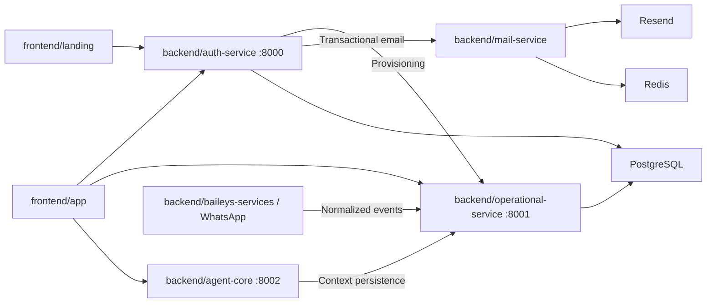

# KronFlow architecture

> **KronFlow — Intelligent CRM** (*Smart conversations. Seamless automation.* · Open Source · By **BLANDSKRON**).

See the [Agents-First protocol](AGENTS.md) and [release readiness](RELEASE_READINESS.md) for current Community v1.0 (`tenant_schema_v21`) boundaries, invariants and verification.

## Service topology & monorepo boundaries

| Boundary | Directory & docs | Responsibilities |
| --- | --- | --- |
| Browser (CRM) | [frontend/app](frontend/app/README.md) | Angular 21 Zoneless SPA: auth and tenant context, HITL inbox, contacts, opportunities pipeline, AI proposals review, campaigns, consolidated KPIs, privacy workflows, agent setup |
| Browser (Landing) | [frontend/landing](frontend/landing/README.md) | Angular 21 Zoneless SPA: public portal, Floating Glassmorphism showcase and CSRF-protected contact form |
| IAM | [backend/auth-service](backend/auth-service/README.md) | Django/DRF: identity, tenant membership, plan state, RBAC data, RS256 JWT issuance, account email |
| Operational | [backend/operational-service](backend/operational-service/README.md) | FastAPI + PostgreSQL 18: tenant provisioning (`tenant_schema_v21`, repeatable `v3–v21`), durable action outbox + worker, consent ledger, HITL control, opportunities, AI proposals, multi-agent platform, DAG workflows, Tool Hub + bidirectional MCP, webchat, Meta/Shopify/Mercado Pago/Twilio + outbound connectors, contact points/forms/credentials, domain events, campaigns/channels, KPIs, privacy/retention, webhooks, private attachments and scheduling |
| Agent Core | [backend/agent-core](backend/agent-core/README.md) | FastAPI: channel-agnostic conversational runtime, business context extraction/RAG, simulation and optional Groq LLM calls |
| Email | [backend/mail-service](backend/mail-service/README.md) | FastAPI + Redis: Bearer authentication, scoped sender keys, idempotency using Redis and delivery through Resend |
| WhatsApp lab | [backend/baileys-services](backend/baileys-services/README.md) | Node/TypeScript: optional private QR pairing and consent-gated text ingestion for one tenant per instance |
| Deployment | [deploy](deploy/README.md) | Modular Docker Compose stacks (`infrastructure`, `bootstrap`, `backend`, `frontend`, `email`, `whatsapp`), credential init and smoke verification |

## Integration contracts & service boundaries

Services never share internal ORM models, SQL queries or domain repositories; every cross-service boundary communicates over explicit HTTP contracts exposed under `/api/v1/` (and runtime `/openapi.json`):

1. **Tenant resolution without trusting `schema_name`:** Public and dashboard contracts never accept a physical database `schema_name`. `operational-service` resolves `schema_name` internally from the authenticated tenant context.
2. **Three strict authentication boundaries:**
   - **Dashboard Angular (`frontend/app`) → `auth-service` / `operational-service` / `agent-core`:** `Authorization: Bearer <JWT RS256>` issued by IAM with `tenant_id`, `roles`, `permissions` and `subscription` claims. Refresh tokens are rejected for API resource access.
   - **Channel adapters (`baileys-services` / external WhatsApp) → `operational-service` ingest:** Rotatable `X-Tenant-Code` + `X-Ingest-Key` (never end-user JWTs).
   - **Service-to-service internal routes (`/internal/*`):** Shared `X-Internal-Token` (`auth-service` → `operational-service` runtime provisioning; `agent-core` → `operational-service` context persistence); never exposed to public clients.
3. **Standard response & error semantics:** Responses follow standard JSON envelopes (`success`, `data`, optional `meta`/`links` and stable pagination), `snake_case` backend payloads, ISO 8601 UTC timestamps and domain-prefixed error codes (`AUTH_*`, `OPERATIONAL_*`, `AI_*`, `TENANT_*`, `WHATSAPP_*`, `PLATFORM_*`).
4. **AI metadata & versioned events:** Conversational AI responses expose model confidence, retrieval `sources`, prepared typed `actions` and `requires_human` handoff state for HITL approval (`at-most-once` execution). Domain events and webhook envelopes carry `event_id`, `event_type`, `event_version`, `occurred_at`, `producer`, `tenant_id` and `correlation_id`.
5. **Backward-compatible cryptographic defaults:** Existing JWT issuer (`JWT_ISSUER=flowkron-auth-service`), audience (`JWT_AUDIENCE=flowkron`), encryption salt (`SIGNING_KEY_ENCRYPTION_SALT=flowkron-auth-service`), `/run/flowkron` container secret mounts and browser storage keys remain preserved to protect existing deployments and session continuity.

IAM issues signing keys at bootstrap and shares the public key with validation services over a read-only mount. PostgreSQL hosts IAM and Operational schemas in one cluster, while Redis handles local cache and mail idempotency. Only local development use is documented for the included Compose configuration.

See [AGENTS.md](AGENTS.md) for invariants/skills and [deploy/README.md](deploy/README.md) for local and smoke deployment notes.
