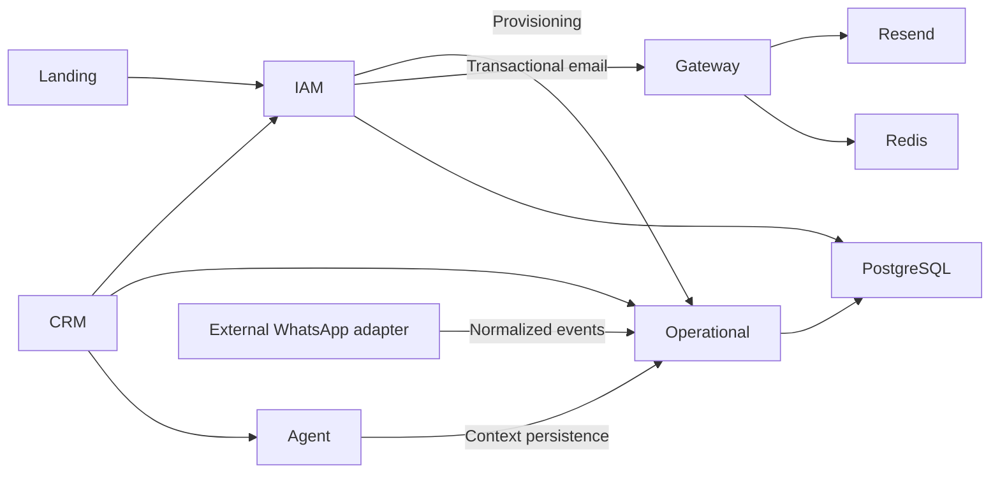

# Flowkron architecture

See the [Community v1 roadmap](EVOLUCION_FLOWKRON.md) and [proposed architecture decisions](docs/planning/v1/02-architecture-adrs.md) for planned changes.

| Boundary | Implementation | Responsibilities |
| --- | --- | --- |
| Browser | [CRM Angular](flowkron-front-app-angular/README.md) and [landing Angular](flowkron-front-landing-angular/README.md) | Auth and tenant context, read-only inbox, operations, agent setup, public contact form |
| IAM | [Django](flowkron-auth-service/README.md) | Identity, tenant membership, plan state, RBAC data, JWT issuance, account email |
| Operational | [FastAPI and PostgreSQL](flowkron-operational-service/README.md) | Tenant provisioning, per-tenant schemas, ingest, leads, conversations and statistics |
| Agent Core | [FastAPI](flowkron-agent-core/README.md) | Channel-agnostic agent API, business context, simulation and optional LLM calls |
| Email | [Blandskron gateway](smtp-http-blandskron/README.md) | Bearer authentication, scoped sender keys, idempotency using Redis and delivery through Resend |
| WhatsApp lab | [Baileys connector](flowkron-baileys-services/README.md) | Optional private QR pairing and consent-gated text ingestion for one tenant per instance |
| Interfaces | [API contracts](flowkron-api-contracts/README.md) | Canonical specifications with partial runtime adoption |

IAM issues JWTs consumed by Operational and Agent Core. Operational resolves database schemas from authenticated tenant context. Ingestion uses separate tenant code and ingest key headers. The email gateway has its own credential and sender allowlist.

The stack uses one PostgreSQL cluster for IAM and Operational and a Redis instance for local cache and mail idempotency. IAM issues signing keys at bootstrap and shares the public key with the validation services. Only local development use is documented for the included Compose configuration.

See the [technical documentation index](flowkron-product-docs/README.md) and the [deployment notes](flowkron-deploy/README.md).
