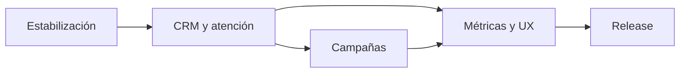

# Roadmap de Flowkron Community v1.0

**Estado al 22 de noviembre de 2026:** source preview Apache-2.0. Flowkron by BLANDSKRON es un CRM AI-native autohospedado y multiempresa. Community v1.0 cubre instalación local, captación, atención humano-IA, ventas, campañas con canal autorizado y métricas verificables. [Alcance MUST/SHOULD/POST](docs/planning/v1/FINAL_SCOPE.md) · [Readiness actual](RELEASE_READINESS.md).

**Base:** `c5da59aed5ae8a1aa63b6413ed81b48b13c58fb7`, con [Validate verde en esa revisión](https://github.com/Blandskron/flowkron/actions/runs/45073728218). La corrección del fixture de consentimiento está en `main`; el job de esa revisión omitía la suite PostgreSQL. El código activo usa schema tenant v8. Se conservan los 27 IDs históricos. El [roadmap previo, decisiones y evidencia histórica](https://github.com/Blandskron/flowkron/blob/c5da59aed5ae8a1aa63b6413ed81b48b13c58fb7/EVOLUCION_FLOWKRON.md) quedan disponibles en ese SHA.

## Índice de evidencia y decisiones

1. [Estado auditado](docs/planning/v1/01-audit.md) y [trazabilidad por ticket](docs/planning/v1/TRACEABILITY.md).
2. [Arquitectura objetivo](docs/planning/v1/02-architecture-adrs.md) y [decisiones](docs/planning/v1/DECISIONS.md).
3. [CRM e inbound](docs/planning/v1/03-inbound-crm.md), [campañas](docs/planning/v1/04-campaigns.md) y [métricas](docs/planning/v1/05-analytics.md).
4. [UX e instalación](docs/planning/v1/06-ux-docs-onboarding.md), [seguridad y calidad](docs/planning/v1/07-security-quality-release.md) y [gates](docs/planning/v1/RELEASE_GATES.md).

IAM mantiene identidad y permisos; Operational conserva contactos, conversaciones, oportunidades y eventos. Campañas y Analytics empiezan como módulos de Operational. PostgreSQL conserva la cola durable y Redis usos efímeros. Agent Core calcula propuestas y el dueño del recurso autoriza efectos. Email real requiere proveedor configurado y evidencia. WhatsApp de campañas se mantiene deshabilitado hasta validar un adaptador autorizado, plantillas y recibos. [ADR](docs/planning/v1/02-architecture-adrs.md) · [Gates por canal](docs/planning/v1/04-campaigns.md#alcance-v1-y-proveedores)

## Fases y salida verificable

| Fase | Entregas en orden de habilitación | Salida de fase |
| --- | --- | --- |
| F1 · Estabilización | Consolidar FK-01/02/05/07/08, cerrar gates mínimos de FK-03/04, habilitar PG en FK-15. FK-16 reconcilia documentación por entrega. | Suite funcional integrada, restore base y upgrade repetible v3–v8 en entorno de prueba. |
| F2 · CRM inbound y HITL | Preparar base de eventos FK-10, scopes FK-12 y directorio FK-28. Cerrar FK-06/19 y pipeline FK-29, definir ejecución acotada FK-17/18. | Formulario o WhatsApp sintético → contacto/lead → conversación → atención → oportunidad. Permisos y transiciones comprobadas. |
| F3 · Campañas e integraciones | FK-14/24 habilitan adaptadores y credenciales; FK-30 incorpora plantilla, audiencia, envío y baja. FK-23 añade correo de conversación si pasa su propio gate. | Demo con stub; email en sandbox autorizado y WhatsApp real condicionado a su gate. |
| F4 · Métricas, UX y documentación | FK-09/16/26 concilian medición e interfaces. Priorizar solo las extensiones SHOULD que pasan sus gates propios. | Dashboard verificable, onboarding y guía pública con pruebas sobre alcance habilitado. |
| F5 · Release | Cerrar FK-15/27 y validar CI, Compose, restore, licencias, seguridad y alcance por canal. | Evidencia firmada por responsables de cada gate y decisión Go/No-Go del SHA candidato. |

## Backlog canónico

`DONE` indica alcance de código cubierto por la evidencia indicada; los gates de release se verifican sobre el candidato. `IN_PROGRESS` indica avance concreto, `TODO` trabajo sin cierre y `BLOCKED` una dependencia externa identificada. P0 protege integridad/egress; P1 completa recorrido de v1; P2 amplía alcance. S/M/L son tamaños relativos. Las personas responsables se asignan en ejecución; la tabla identifica el componente dueño. La [trazabilidad](docs/planning/v1/TRACEABILITY.md) identifica archivos y pruebas. Las categorías de rollback se definen al final de la tabla.

| ID | Estado | Fase · prioridad · tamaño | Dueño | Dependencias | Aceptación y rollback |
| --- | --- | --- | --- | --- | --- |
| FK-01 · Identidad de mensajes | DONE | F1 · P0 · M | Operational, Contratos | — | Identidad durable, dedup y upgrade preservan historial. R2. |
| FK-02 · Turnos recuperables | DONE | F1 · P0 · L | Operational, Conector | FK-01 | Reclamación, reinicio y reconciliación sin reenvío ciego. R2/R3. |
| FK-03 · Trabajos durables | IN_PROGRESS | F1 · P0 · L | Operational, Conector | FK-02 | Cola WhatsApp validada. Cerrar trabajo durable y outbox de acciones en su propio alcance. R2/R3. |
| FK-04 · Consentimiento al ejecutar | IN_PROGRESS | F1/F3 · P0 · M | Operational, Canales | FK-02/03 | BAJA, orden v8 e historial en Contactos comprobados. Elegibilidad por canal y finalidad verificada con datos sintéticos. Queda la autorización transaccional del worker. R2/R3. |
| FK-05 · Diagnóstico de conexión | DONE | F1 · P1 · M | IAM, Conector, CRM | — | QR y diagnóstico aislados y probados con adaptador sintético. R1/R3. |
| FK-06 · Atención humana y envío | IN_PROGRESS | F2 · P0 · L | Operational, IAM, CRM, Conector | FK-02/04/19 | Handoff visible. Restan reclamar, responder, resolver y devolver control con un único actor activo. R2/R3. |
| FK-07 · Recibos y estados | DONE | F1 · P0 · M | Operational, Conector, CRM | FK-01/02 | Recibos normalizados de WhatsApp directo y estados inciertos reconciliables. R2/R3. |
| FK-08 · Inbox y búsqueda | DONE | F1 · P1 · M | Operational, CRM | FK-01 | Paginación, búsqueda SQL y marcas de lectura concurrentes. R1/R2. |
| FK-09 · Trazas y métricas | IN_PROGRESS | F4 · P1 · M | Operational, Agent, CRM | FK-01/02/03/10 | Metadata tenant y conteo de Bandeja alineados. Completar KPIs por eventos y correlación entre servicios. R1/R2. |
| FK-10 · Eventos de dominio | IN_PROGRESS | F2 · P1 · M | Operational, Contratos | FK-01/02 | Envelope existente. Persistir eventos versionados con replay y suscripciones tenantizadas. R2/R3. |
| FK-11 · Entrega fiable de webhooks | TODO | POST-v1 · P2 · L | Operational, Deploy, CRM | FK-03/09/10 | Firma, intentos acotados, dedup y diagnóstico por suscripción. R2/R3. |
| FK-12 · Credenciales acotadas | IN_PROGRESS | F2 · P0 · M | IAM, Operational | FK-10 | Emitir, usar y revocar scope `leads:create`; verificar expiración y credencial ajena. R1/R3. |
| FK-13 · Adjuntos privados | TODO | POST-v1 · P2 · M | Operational, Conector, CRM | FK-01/02/04 | Tamaños, acceso por recurso y retención comprobados. R2/R3. |
| FK-14 · Conexiones y proveedores | IN_PROGRESS | F3 · P1 · L | Canales, IAM, Contratos | FK-01/05/07 | Mantener aislamiento por conexión; adaptar proveedores habilitados con pruebas propias. R1/R3. |
| FK-15 · Recuperación y CI | IN_PROGRESS | F1/F5 · P0 · L | Deploy, Operational, CI | Incremental desde FK-01 | PG en CI, smoke estándar/demo, upgrade y restore; validar SHA candidato. R4. |
| FK-16 · Documentación verificable | DONE | F1/F4 · P1 · S | Dueño de cada módulo | Por cada entrega | Inventario y recorridos verificados contra el código de source preview. Revalidar el contenido publicado sobre el candidato en F4. R1. |
| FK-17 · Propuestas y ejecución | IN_PROGRESS | F2 · P0 · L | Agent, Operational, Contratos | FK-02/03/04 | Efectos tipados, permiso vigente, idempotencia y auditoría antes de ejecutar. R2/R3. |
| FK-18 · Revisión de acciones | TODO | F2 · P1 · M | Operational, IAM, CRM | FK-17 | Revisar y decidir propuestas versionadas con autorización por recurso. R1/R3. |
| FK-19 · Control efectivo de IA | IN_PROGRESS | F2 · P0 · M | Operational, Agent, IAM, CRM | FK-04 | Policy de empresa y conversación impide permisos IA tras toma humana o suspensión. R2/R3. |
| FK-20 · Memoria acotada | IN_PROGRESS | F2 · P2 · L | Operational, Agent | FK-01/02/04 | Recuperar solo evidencia mínima por conversación y verificar retención. R1/R2. |
| FK-21 · Datos confirmados | IN_PROGRESS | F2 · P2 · M | Operational, Agent, CRM | FK-17/20 | Enriquecimiento autorizado con fuente y control de conflicto. R2/R3. |
| FK-22 · Agenda conversacional | TODO | POST-v1 · P2 · L | Operational, Agent, CRM | FK-17/18/20/24 | Simular y luego confirmar disponibilidad sin reservar doble. R2/R3. |
| FK-23 · Correo vinculado a conversación | TODO | SHOULD F3 · P2 · L | Operational, Gateway, CRM | FK-17/18; FK-24 si delegado | Envío y evidencia visibles en el hilo bajo permisos. El transporte existente se reutiliza para FK-30. R3. |
| FK-24 · Integraciones delegadas | IN_PROGRESS | F3 · P1 · L | IAM, Operational, Deploy, CRM | FK-04/09 inicial | Remitente o cuenta vinculada al tenant, rotación y revocación verificadas. R1/R3. |
| FK-25 · Notificaciones | IN_PROGRESS | SHOULD F4 · P2 · M | Operational, CRM, Gateway | FK-02/03/09 | Cola vigente e historial de derivaciones accesibles en CRM. Quedan entregas externas y sus permisos. R1/R2. |
| FK-26 · Evaluación y presupuestos de IA | IN_PROGRESS | F4 · P1 · M | Agent, Operational, Contratos | FK-09/20 | Dataset sintético y presupuesto por solicitud verificados. Quedan cobertura de trazas integradas, validación semántica y medición de coste. R1/R2. |
| FK-27 · Privacidad y retención | IN_PROGRESS | F5 · P0 · L | Operational, IAM, CRM, Deploy | FK-03/04/09 | Resolver solicitudes y comprobar retención sobre almacenes activos y backups. R2/R3. |
| FK-28 · Directorio y captación CRM | IN_PROGRESS | F2 · P0 · L | Operational, CRM, IAM | FK-04/12 | Directorio, ficha y alta manual comprobados. Quedan identidad multicanal persistente, captación por formulario o integración y consentimiento por canal/propósito. R2/R3. |
| FK-29 · Pipeline comercial | TODO | F2 · P1 · M | Operational, CRM | FK-28 | Oportunidad persistente con etapas, responsable y resultado para dos tenants. R1/R2. |
| FK-30 · Campañas y plantillas | IN_PROGRESS | F3 · P0 · L | Operational, Canales, CRM | FK-03/04/10/14/24/28 | [Elegibilidad y reevaluación sintéticas](docs/planning/v1/04-campaigns.md#prueba-local-de-elegibilidad-por-destinatario). Quedan plantillas, aprobación persistida, worker con stub, recibos y habilitación por canal. R2/R3. |

**Rollback.** R1 revierte ruta, frontend o configuración compatible. R2 detiene escritores nuevos, revierte binarios compatibles y conserva tablas/evidencia aditivas; validar backup y restauración en aislado. R3 bloquea efecto o conector y conserva cola, IDs y estados inciertos para conciliar antes de reactivar. R4 revierte el cambio de CI o runbook y deja el gate correspondiente con evidencia pendiente.

## Ejecución y cierre

- **Validación remota de FK-15:** en `c65a364`, Validate pasó con PostgreSQL 18.7, OpenAPI y Compose estándar/demo. Operacional registró 61 pruebas aprobadas y una omisión del benchmark opcional. Quedan los gates de upgrade, restore y release sobre el candidato. [Evidencia](flowkron-operational-service/docs/TESTING.md#integración-postgresql-en-validate-fk-15)
- **Entregas de FK-28:** el directorio y la ficha de lectura operan sobre `Cliente`, con búsqueda telefónica tolerante al formato, filtro por origen y recuperación del contexto de navegación. Se preservan clientes y referencias existentes. [Contrato y alcance](flowkron-operational-service/docs/API.md#contactos)
- **Actividad de contacto y seguimiento comercial:** la ficha enlaza leads y conversaciones y permite editar el nombre con `crm.manage`. La pantalla de seguimiento usa las etapas existentes de `Lead`, tiene búsqueda y filtros SQL y registra el cambio de etapa. La oportunidad independiente de FK-29 queda pendiente. [Rutas CRM](flowkron-front-app-angular/docs/ROUTES_AND_APIS.md)
- **Entrega de FK-09:** el resumen lee todos sus agregados en una consulta PostgreSQL y conserva el contrato existente. [Pruebas de consistencia](flowkron-operational-service/tests/test_conversation_inbox.py)
- **Puntos de contacto en FK-28:** la ficha deriva correo y teléfono normalizados cuando el formato lo permite. El diagnóstico de CSV cuenta duplicados y casos sin resolver por empresa. Quedan la persistencia de puntos, el backfill repetible con preservación de referencias y la política de colisiones. Captación pública y acciones humanas conservan sus dependencias. [Diagnóstico y rollback](flowkron-operational-service/docs/TESTING.md#perfil-de-puntos-de-contacto-fk-28)
- **Continuidad del seguimiento CRM:** filtros y páginas se restauran desde la navegación. La ficha y cada actividad permiten reintentar, las ediciones concurrentes recuperan el valor vigente y el listado corrige páginas que quedan vacías al cambiar de etapa. La oportunidad persistente sigue en FK-29. [Rutas y comportamiento](flowkron-front-app-angular/docs/ROUTES_AND_APIS.md)
- **Actividad diaria de FK-09:** altas de contactos y leads y mensajes por dirección, con rangos locales, corte y totales reconciliados. La pantalla separa cero actividad de una proporción sin denominador. Quedan métricas por eventos y correlación entre servicios. [Contrato y límites](flowkron-operational-service/docs/API.md#analytics)
- **Plan de backfill de FK-28:** el CSV con IDs produce candidatos ordenados, grupos en colisión y formatos sin resolver por tipo de punto. Quedan la persistencia y la ejecución del backfill. [Ejecución de solo lectura](flowkron-operational-service/docs/TESTING.md#plan-de-backfill-de-solo-lectura-fk-28)
- **Restauración sintética de FK-15:** PostgreSQL 18 restauró dos empresas en una base nueva y conservó relaciones, consentimiento y deduplicación. Quedan el ensayo de backup cifrado, la matriz de upgrade y los gates del candidato. [Ensayo y límites](flowkron-operational-service/docs/OPERATIONS.md#ensayo-de-restauración-multiempresa)
- **Evaluación y presupuesto por solicitud en FK-26:** Agent Core unifica las derivaciones por baja confianza en ambos modos, limita los extractos enviados y observa latencia y tokens informados por el proveedor. La suite sintética cubre faltas de contexto, presupuesto, fallos y aislamiento. [Dataset, rúbrica y límites](flowkron-agent-core/docs/agent/EVALUATION.md)
- **Seguimiento manual desde Contactos:** un operador puede iniciar el lead inicial de un contacto existente, calificar etapa y temperatura y consultar su historial con `audit.read`. Un fixture sintético permite recorrer la entrega en la demo sin conexión a WhatsApp. La oportunidad persistente sigue pendiente en FK-29. [Prueba manual](docs/planning/v1/MANUAL_CRM_QA.md)
- **Historial de derivaciones en FK-25:** Notificaciones separa la cola vigente de los eventos persistidos y pagina ambas vistas. Las derivaciones conservan enlaces a la conversación o al lead disponible. [Prueba manual](docs/planning/v1/MANUAL_NOTIFICATIONS_QA.md)
- **Alta manual en FK-28:** el operador crea y edita un contacto desde el CRM, reintenta el alta con el mismo UUID y continúa al lead inicial. La edición valida formatos y detecta cambios concurrentes. [Prueba manual sin SQL](docs/planning/v1/MANUAL_CRM_QA.md#crear-el-contacto-desde-la-interfaz)
- **Ensayos locales de FK-15:** seis perfiles sintéticos v3–v8 se migraron dos veces. Se verificó el rollback ante un fallo inducido, la exclusión de runtimes suspendidos del barrido y la restauración autenticada de una copia cifrada de Operational. Quedan las pruebas sobre un candidato completo. [Evidencia](flowkron-operational-service/docs/TESTING.md#actividad-diaria-y-restauración-lógica)
- **Bandeja de FK-27:** se puede consultar, revisar y registrar el cierre confirmado de solicitudes con los permisos existentes. La auditoría conserva actor, estado y fecha. Quedan la ejecución y la retención sobre almacenes y copias. [Prueba manual](docs/planning/v1/MANUAL_PRIVACY_QA.md)
- **FK-16 cerrado para source preview:** se reconciliaron el inventario transversal, los contratos y los recorridos que ya se pueden probar. El [estado de cierre](docs/planning/v1/RELEASE_GATES.md#trabajo-en-curso-por-verificar) identifica lo que resta por ticket. [Inventario verificado](flowkron-product-docs/04-architecture/00-current-implementation-status.md)
- **Trazabilidad de FK-09/FK-10:** el CRM consulta eventos seleccionados de la auditoría persistida por empresa y UUID. Agent Core propaga la correlación válida en las llamadas de contexto a Operational. Quedan la cobertura de los demás canales, el replay hacia delante y las suscripciones. [Prueba manual](docs/planning/v1/MANUAL_AUDIT_QA.md)
- **Cierre por ticket:** comparar con el contrato vigente, documentar cambio, rollback y riesgos, probar éxito, errores y aislamiento aplicables con datos sintéticos y enlazar evidencia exacta. Marcar `DONE` al cumplir el alcance. **Cierre de v1:** satisfacer [alcance y gates](docs/planning/v1/RELEASE_GATES.md) sobre un SHA y declarar explícitamente canales/funciones habilitadas.
