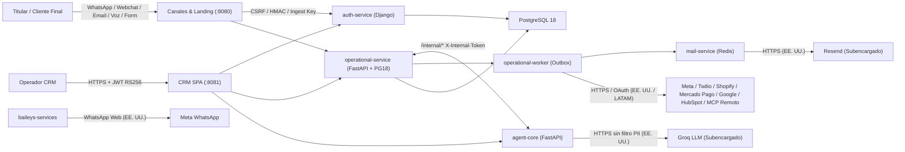

# Auditoría Universal de Privacidad, Seguridad y Cumplimiento Normativo — KronFlow

**Proyecto:** KronFlow — Intelligent CRM (*By BLANDSKRON*, Apache-2.0)  
**Corte técnico auditado:** `main` (`tenant_schema_v21`, commit `169db37`) · **Fecha de auditoría:** 26 de noviembre de 2026  
**Alcance:** Investigación normativa, inspección integral de código/arquitectura/infraestructura, análisis de brechas, registro de riesgos y arquitectura objetivo. *(Fase exclusivamente de auditoría y planificación; sin modificaciones funcionales al código.)*  
**Documento compañero:** [PRIVACY_COMPLIANCE_ROADMAP.md](PRIVACY_COMPLIANCE_ROADMAP.md) (Ciclos 0–9, Backlog ejecutable `PRV-001`–`PRV-034`, Estrategia de Pruebas y Quality Gates `QG-0`–`QG-9`).

---

## 1. Informe Ejecutivo de Auditoría

### 1.1 Resumen de madurez actual
KronFlow cuenta con una **base arquitectónica sólida para aislamiento multi-tenant y gobernanza operativa**:
- Aislamiento físico por esquema PostgreSQL 18 (`schema_translate_map`), tres fronteras estrictas de autenticación (`JWT RS256`, `X-Tenant-Code` + `X-Ingest-Key` / HMAC, `X-Internal-Token`), control HITL con CAS, ledger persistente de consentimiento y supresión (`contact_consent_decisions`, `contact_suppressions`), propuestas IA `at-most-once` y flujos iniciales de exportación, borrado y retención (`privacy_case_service.py`).

Sin embargo, la auditoría de código identificó **brechas críticas y altas que impiden declarar cumplimiento normativo demostrable** frente a **Ley 19.628 / Ley 21.719 (Chile)**, **Ley 21.663 (Ciberseguridad Chile, vigente)**, **GDPR (UE 2016/679)**, **EU AI Act Art. 50 (vigente desde agosto 2026)** y estándares **ISO/IEC 27701:2025 / 27001:2022 / 29151:2026 / 29184:2020 / TS 27560:2023 / 31700-1:2023**:

1. **Borrado incompleto y fuga de PII residual en `execute_privacy_erasure` (`Crítico`):** el flujo de supresión en `backend/operational-service/app/services/privacy_case_service.py` anonimiza `nombre`, `email`, `telefono` y `whatsapp_id`, pero **deja intacto `clientes.rut`** (identificador nacional único en Chile), no redacta `conversaciones.message`, `conversaciones_resumen`, `leads.resumen_ia`, `opportunity_activities.note`, `ai_action_proposals.arguments_json`, `domain_events.payload` ni `solicitudes_derechos.whatsapp_id`, y solo registra supresión para WhatsApp (omitiendo el `email` que se borró antes de registrar la supresión).
2. **Ausencia total de ciclo de vida DSAR y retención en `auth-service` (`Crítico`):** no existen endpoints de exportación, rectificación ni supresión/anonimización para usuarios IAM (`iam_user_profile`), mensajes del formulario de contacto (`iam_contact_message`, que almacena IP, `user_agent`, correo y teléfono) ni depuración de `iam_audit_log` (que registra `email` en `LOGIN_FAILED`). Además, archivar/eliminar un tenant en IAM **no purga su schema PostgreSQL** en Operational.
3. **Retención manual y parcial (`Crítico`):** `run_retention_sweep` solo se invoca manualmente y solo elimina filas en `mensajes_dashboard`; `operational-worker` (`app/worker.py`) no ejecuta barridos programados ni purga memoria IA, adjuntos expirados, transcripciones de voz, trazas, sesiones webchat ni copias de respaldo.
4. **Exportación incompleta para portabilidad y acceso (`Alto`):** `export_privacy_case_data` devuelve únicamente `message_count` (conteo) y conteos de sesiones/llamadas/pedidos en vez de la copia estructurada de los datos personales del titular; además, las solicitudes `solicitudes_derechos` dependen exclusivamente de `whatsapp_id`, excluyendo a titulares captados por correo, formularios o webchat.
5. **Egreso sin minimización ni control hacia LLM y subencargados externos (`Alto`):** `GroqClient.complete()` (`backend/agent-core/app/infrastructure/llm/groq.py`) envía mensajes crudos del usuario, fragmentos RAG y `ConversationMemoryItem` a `api.groq.com` (EE. UU.) sin redacción/seudonimización previa de PII, sin gate por tenant de transferencia internacional y sin aviso obligatorio de interacción con IA (EU AI Act Art. 50).
6. **Transparencia, avisos de privacidad y recibos de consentimiento insuficientes (`Alto`):** `frontend/landing/.../privacy-policy.component.html` es un texto genérico de 3 líneas; el formulario de contacto solo usa un checkbox `accept_terms` sin versión de aviso ni recibo estructurado (`ISO/IEC TS 27560:2023`).
7. **Seguridad de sesión frontend y cabeceras HTTP (`Alto`):** `frontend/app` almacena access y refresh tokens en `localStorage` (superficie XSS), `nginx.conf` carece de `Content-Security-Policy` (CSP) y `Strict-Transport-Security` (HSTS), y Operational/Agent Core validan JWT localmente sin lista de revocación rápida.
8. **Gestión de incidentes y brechas de datos inexistente (`Alto`):** no existe registro de incidentes, flujo de clasificación de severidad ni runbook/alerta alineado con los plazos legales (**3 horas alerta temprana CSIRT/ANCI bajo Ley 21.663 Chile** y **72 horas autoridad de control bajo GDPR Art. 33 / Ley 21.719**).

> **Nota sobre estado de CI al corte (`169db37`):** en la corrida `Validate 45929317712`, 10/11 jobs pasaron (incluidos `secrets`, `auth-service`, `agent-core`, `mail-service`, `frontend/*`, `whatsapp-lab` y ambos smoke Compose estándar/demo); únicamente falló `python (backend/operational-service)` por `test_demo_seed.py` (harness de prueba recién añadido, fuera del alcance de esta fase no modificadora).

### 1.2 Frontera estricta: Ingeniería vs. Obligaciones Jurídicas / Organizacionales
El código **puede y debe** habilitar controles técnicos verificables, pero **nunca sustituye** las obligaciones que requieren revisión jurídica, contractual y de gobierno humano:
- **Resolvible por ingeniería:** anonimización completa (incl. RUT), exportación estructurada multicanal, purga programada, minimización/redacción PII pre-LLM, CSP/HSTS/cookies HttpOnly, registros de consentimiento interoperables (`ISO/IEC TS 27560`), registros de incidentes y pruebas automatizadas (*Compliance as Code*).
- **Requiere revisión jurídica/contractual/organizacional (no resolvable solo con código):** redacción legal final de Políticas de Privacidad y Términos por cada operador/tenant; firma de DPAs y Cláusulas Contractuales Tipo (SCC) / evaluaciones TIA con Groq, Resend, Meta, Twilio, Google, Shopify y HubSpot; designación formal de Delegado de Protección de Datos (DPO / Encargado de Prevención de Delitos de Datos bajo Ley 21.719); registro oficial de actividades de tratamiento (RoPA) y aprobación legal de DPIA; calificación de OIV y reporte oficial ante ANCI/CSIRT (Ley 21.663) o Agencia de Protección de Datos Personales; y políticas de retención/purga sobre backups externos y contratos laborales/comerciales.

---

## 2. Matriz de Aplicabilidad Normativa y Estándares

> Versiones y vigencias contrastadas con fuentes oficiales al **26 de noviembre de 2026**.

| Marco / Norma | Naturaleza | Versión / Estado vigente | Fecha de aplicación | Aplicabilidad a KronFlow |
| --- | --- | --- | --- | --- |
| **Ley N° 19.628 (Chile)** | **Obligación legal** | Vigente (con reformas previas) | En vigor actualmente | **Directa** para instancias/operadores en Chile mientras entra en vigor la Ley 21.719 (consentimiento escrito/electrónico, derechos ARCO, protección de datos sensibles). |
| **Ley N° 21.719 (Chile)** *(modificada por Ley N° 21.855)* | **Obligación legal** | Publicada 13 dic 2024; **Ley 21.855 (23 nov 2026)** postergó vigencia | **15 de octubre de 2027** *(plazo original era 1 dic 2026)* | **Directa y prioritaria** (producto originado en Chile, RUT, CLP, Mercado Pago CL). Exige bases de licitud, derechos ARCOP+B (acceso, rectificación, supresión, oposición, portabilidad, bloqueo), decisiones automatizadas, notificación de brechas, transferencias internacionales, privacidad desde el diseño y modelo de prevención de infracciones ante la Agencia. |
| **Ley N° 21.663 (Chile — Ciberseguridad)** | **Obligación legal** | Vigente (DFL 1-21.663 dic 2024; ANCI operativa) | **1 ene 2025 / 1 mar 2025** (plena vigencia) | **Directa** si el operador presta servicios esenciales o es calificado OIV en Chile; buena práctica obligada en SaaS B2B chileno (reporte de incidentes graves al CSIRT Nacional en 3h alerta temprana / 72h actualización / 15 días informe final). |
| **GDPR — Reglamento (UE) 2016/679** | **Obligación legal** | Vigente | Desde 25 may 2018 | **Directa** si cualquier tenant trata datos de personas en el EEE (Art. 3.2) o establece operación en la UE (Art. 5–7, 12–22, 24–36, 44–49). Referencia base global del diseño. |
| **EU AI Act — Reg. (UE) 2024/1689** *(+ Digital Omnibus Reg. 2026/1744)* | **Obligación legal** | Vigente por fases | Art. 5 (feb 2025), GPAI (ago 2025), **Art. 50 transparencia (2 ago 2026)**; Alto Riesgo trasladado a dic 2027 / ago 2028 | **Aplicable (Art. 50 ya vigente)** para instancias con usuarios en la UE: obligación explícita de informar que interactúan con un sistema IA (chatbots WhatsApp/webchat/voz) y transparencia sobre contenido sintético. |
| **Directiva ePrivacy (2002/58/CE) / Ley 19.496 Art. 28B (Chile)** | **Obligación legal** | Vigentes | En vigor | **Directa** para comunicaciones comerciales no solicitadas (campañas email/WhatsApp), enlaces de baja y cookies/almacenamiento local en navegadores. |
| **LGPD (Brasil, Ley 13.709/2018) / LFPDPPP (México) / Ley 1581 (Colombia)** | **Obligación legal territorial** | Vigentes | En vigor | **Condicional** si tenants operan con titulares en dichos países LATAM; cubiertas en gran medida al cumplir el estándar combinado GDPR + Ley 21.719. |
| **PCI-DSS v4.0.1** | **Estándar sectorial contractual** | Vigente | En vigor | **Reducida / Fuera de alcance directo** siempre que KronFlow mantenga el invariante actual de **no recopilar, procesar ni almacenar datos de tarjetas** (delegando checkout a Shopify/Mercado Pago). |
| **ISO/IEC 27701:2025** | **Estándar voluntario certificable** | **Edición 2025 (oct 2025) — Standalone PIMS** | Vigente (transición desde 2019) | **Alto valor:** marco certificable independiente para PIMS (Controlador y Procesador), alineado con 27001:2022 y 27002:2022. Define controles específicos para KronFlow como *PII Processor* (SaaS) y *PII Controller* (IAM/Landing). |
| **ISO/IEC 27001:2022 & 27002:2022** | **Estándar voluntario certificable** | Edición 2022 | Vigente | **Base de seguridad** (93 controles: organizacionales, personas, físicos y tecnológicos: criptografía, IAM, logging, gestión de vulnerabilidades, incidentes, proveedores). |
| **ISO/IEC 29100:2024** | **Estándar voluntario (marco)** | 2ª edición (feb 2024) | Vigente | Define roles (PII Principal, Controller, Processor) y 11 principios de privacidad usados como taxonomía en esta auditoría. |
| **ISO/IEC 29151:2026** | **Estándar voluntario (controles PII)** | 2ª edición (2026), alineada con 27002:2022 | Vigente | Guía de controles técnicos de protección de PII en todo el ciclo de vida. |
| **ISO/IEC 29134:2023** | **Estándar voluntario (PIA/DPIA)** | 2ª edición (may 2023) | Vigente | Metodología para ejecutar evaluaciones de impacto de privacidad (obligatorias ante profiling IA, voz, omnicanal y transferencias). |
| **ISO/IEC 29184:2020** | **Estándar voluntario (avisos)** | 1ª edición (2020) | Vigente | Estructura y controles obligatorios para avisos de privacidad online y captura de consentimiento granular. |
| **ISO/IEC TS 27560:2023** | **Especificación técnica** | Edición 2023 | Vigente | Estructura JSON interoperable para registros y recibos de consentimiento verificables. |
| **ISO/IEC 31700-1:2023 & TR 31700-2:2026** | **Estándar voluntario (PbD)** | Parte 1 (2023) + TR Parte 2 (2026) | Vigente | Operacionalización de *Privacy by Design* y *Privacy by Default* durante todo el ciclo de vida del producto digital. |
| **NIST Privacy Framework** | **Marco voluntario** | **v1.0 (2020) / v1.1 IPD (CSWP 40)** | v1.0 vigente; v1.1 en borrador público | Alineado con NIST CSF 2.0; v1.1 añade gestión específica de riesgos de **privacidad en IA** (sección 1.2.2). |
| **OECD Privacy Guidelines** | **Directrices internacionales** | Revisión 2013 (+ guías de implementación) | Vigente | Principios de limitación de recolección, calidad, especificación de finalidad, seguridad, transparencia, participación individual y *accountability*. |

---

## 3. Inventario de Datos Personales, Roles y Mapa de Flujos

### 3.1 Roles de Tratamiento
- **Operador de instancia KronFlow (ej. BLANDSKRON en SaaS gestionado):**
  - **Responsable del Tratamiento (*PII Controller*):** respecto a usuarios IAM (`auth-service`), formularios de contacto de `frontend/landing`, logs de seguridad/auditoría de plataforma y facturación SaaS.
  - **Encargado del Tratamiento (*PII Processor*):** respecto a los datos comerciales de clientes finales almacenados en cada `tenant_<slug>` de `operational-service`, sesiones de `baileys-services`, procesamiento RAG en `agent-core` y despacho en `mail-service`.
- **Empresa cliente (Tenant):** **Responsable del Tratamiento** de sus contactos, leads, conversaciones, grabaciones/transcripciones, campañas y adjuntos.

### 3.2 Inventario de Datos Personales por Servicio y Almacén

| Servicio | Tabla / Almacén | Categorías de PII / Datos sensibles | Sensibilidad | Base de licitud esperada | Retención actual en código |
| --- | --- | --- | --- | --- | --- |
| `auth-service` | `auth_user`, `iam_user_profile` | Email, username, hash Argon2, `display_name`, `phone`, `avatar_url`, `google_subject`, estado MFA | Media / Alta (credenciales) | Ejecución de contrato | **Indefinida** (sin purga ni borrado de cuenta) |
| `auth-service` | `iam_contact_message` | `name`, `email`, `company`, `phone`, `message`, `ip_address`, `user_agent` | Media | Consentimiento / interés legítimo | **Indefinida** (sin purga) |
| `auth-service` | `iam_audit_log`, sesiones, `axes` | `user_id`, IP, `user_agent`, `email` en `LOGIN_FAILED` (`views.py:40`), eventos RBAC | Media | Interés legítimo / obligación legal | **Indefinida** |
| `operational-service` | `tenant.clientes`, `contact_points`, `lead_captures` | **`rut` (ID nacional Chile)**, `nombre`, `email`, `telefono`, `whatsapp_id`, historial de consentimiento | **Alta** (RUT = identificador único) | Consentimiento / contrato | Anonimización manual **incompleta** (RUT queda intacto) |
| `operational-service` | `tenant.leads`, `opportunities`, `opportunity_activities` | `score_lead`, `clasificacion`, `requiere_credito` (dato financiero), `resumen_ia`, notas | Media / Alta (profiling + crédito) | Contrato / interés legítimo | **Indefinida**; no se redacta en `/erase` |
| `operational-service` | `tenant.conversaciones`, `mensajes_dashboard`, `conversaciones_resumen` | Texto libre de conversaciones (puede contener **datos sensibles** enviados espontáneamente por el cliente) | **Alta** (contenido no estructurado) | Consentimiento / contrato | `run_retention_sweep` manual solo borra `mensajes_dashboard`; `/erase` solo redacta `mensajes_dashboard` |
| `operational-service` | `tenant.conversation_memory_items`, `agent_execution_traces` | Hechos extraídos por IA, prompts/respuestas y citas | **Alta** | Consentimiento / contrato | Memoria tiene TTL manual y se borra en `/erase`; trazas sin purga automática |
| `operational-service` | `tenant.voice_call_sessions`, `voice_call_segments` | Números telefónicos (`from_number`, `to_number`), transcripciones, `recording_consent`, referencia a grabación | **Alta** (voz/biometría potencial) | Consentimiento expreso | `/erase` redacta números y transcripciones; sin purga automática por TTL |
| `operational-service` | `tenant.private_attachments` + disco local | Archivos subidos (PDF, imágenes, audio) con SHA-256 | **Alta** (puede incluir cédulas/salud) | Contrato / consentimiento | TTL implementado pero **no agendado** en `worker.py`; `/erase` sí los elimina |
| `operational-service` | `tenant.solicitudes_derechos`, `contact_consent_decisions`, `contact_suppressions` | `whatsapp_id`, `destination` (email/teléfono), notas, trazabilidad de baja | Media | Obligación legal | Conservación probatoria necesaria; `whatsapp_id` en texto claro |
| `operational-service` | `tenant.commerce_orders`, `external_entity_mappings`, `domain_events`, `action_outbox_jobs`, `public.system_events` | IDs de cliente, montos, payloads JSONB de eventos y trabajos salientes | Media | Contrato / obligación tributaria | **Sin purga ni redacción en `/erase`** |
| `agent-core` | Runtime en memoria / HTTP a Groq | Mensajes de usuario, chunks RAG, memoria conversacional | **Alta** | Contrato / consentimiento transferencia | Efímero en modo `operational`, pero **egresa a Groq (EE. UU.) sin redacción** |
| `mail-service` | Redis (idempotencia) + memoria (dedup webhooks) | Claves de idempotencia, destinatarios enviados a Resend HTTPS | Media | Contrato / consentimiento | Redis con TTL; dedup webhook en memoria de proceso |
| `baileys-services` | Volumen `baileys-lab-sessions` + cola en memoria | Credenciales de sesión WhatsApp Web, JIDs, mensajes en tránsito | **Alta** | Consentimiento (`ACEPTO`/`BAJA`) | Persistente hasta `DELETE /session` |
| `frontend/app` | `localStorage` del navegador | `flowkron.access_token`, `flowkron.refresh_token`, `flowkron.tenant_id`, `theme` | **Alta** (credenciales de sesión) | Estrictamente necesario (sesión) | Hasta logout o expiración (expuesto a XSS) |

### 3.3 Mapa de Flujos de Datos y Transferencias Internacionales

---

## 4. Evaluación Especializada de Inteligencia Artificial (LLM, RAG, Memoria y MCP)

| Superficie IA | Evidencia técnica verificada | Riesgo de privacidad y cumplimiento |
| --- | --- | --- |
| **Egreso a LLM externo (Groq)** | `backend/agent-core/app/infrastructure/llm/groq.py:66-75` envía `messages` completos a `https://api.groq.com/openai/v1/chat/completions`. No existe filtro DLP/PII ni opción por tenant para bloquear envío a proveedor externo. | **Crítico:** Transferencia internacional a EE. UU. de PII y potenciales datos sensibles escritos por clientes en WhatsApp/Webchat sin base legal verificada, sin minimización (GDPR Art. 5.1.c, 44–49; Ley 21.719 Art. 27) y sin verificación contractual de *zero-data-retention / no-training*. |
| **Inyección de memoria en prompts** | `backend/agent-core/app/application/orchestration/agent_runtime.py:82-86` concatena hasta 5 `ConversationMemoryItem` directamente en el prompt del sistema enviado al LLM. | **Alto:** Datos personales memorizados pueden filtrarse al proveedor LLM o influir respuestas sin consentimiento informado ni visibilidad para el titular. |
| **RAG y documentos empresariales** | `context_service.py` almacena `business_context_documents` y `document_chunks` aislados por schema tenant (`allowed_document_ids` por agente). | **Medio:** Aislamiento multi-tenant correcto, pero falta validación anti-PII en documentos subidos y política de reindexación/invalidación inmediata cuando se revoca un documento con PII. |
| **Agentes autónomos y propuestas** | `ai_proposal_service.py` restringe mutaciones a 4 acciones tipadas con aprobación HITL (`at-most-once`), expiración y versión optimista. | **Fortaleza verificada** (*Human-in-the-Loop*). Mantener prohibición de ejecución autónoma sin aprobación para acciones con efecto legal o comercial significativo. |
| **MCP bidireccional** | `mcp_service.py` (servidor) y `mcp_client_service.py` (cliente remoto con allowlist HTTPS y guarda SSRF). | **Alto:** Un servidor MCP remoto aprobado por un tenant puede recibir argumentos con PII del CRM sin clasificación de subencargado, sin redacción de campos sensibles ni registro de transferencia internacional. |
| **Decisiones automatizadas y profiling** | `leads.score_lead`, `leads.clasificacion` (`caliente`/`tibio`/`frio`), `leads.requiere_credito` y disparadores de workflows `lead.temperature.changed`. | **Medio/Alto:** Si un tenant usa scoring para denegar atención, crédito o condiciones comerciales, aplica GDPR Art. 22 y Ley 21.719 Art. 8 bis (derecho a explicación, intervención humana e impugnación). |
| **Transparencia de interacción IA** | `webchat_service.py` y respuestas automáticas WhatsApp no fuerzan un encabezado/bandera estándar informando que responde un sistema de IA. | **Alto (EU AI Act Art. 50 vigente desde ago 2026):** Obligación de informar de forma clara y oportuna que el usuario interactúa con un sistema de IA. |

---

## 5. Matriz de Brechas y Trazabilidad Normativa

**Leyenda de estado:** `Cumplido` · `Parcialmente cumplido` · `Incumplido` · `No aplicable` · `Pendiente de verificación`

| ID | Dominio | Referencia normativa / control | Estado actual | Evidencia técnica verificada | Brecha de cumplimiento | Riesgo / Impacto | Adaptación propuesta | Prioridad | Dependencias | Criterio de aceptación y validación |
| --- | --- | --- | --- | --- | --- | --- | --- | --- | --- | --- |
| **GAP-01** | Inventario y clasificación de datos | GDPR Art. 30 · Ley 21.719 Art. 14 quater · ISO 27701:2025 §7.2.8 · ISO 29100 | **Parcialmente cumplido** | Modelos SQLAlchemy (`tenant_models/*`) y Django (`accounts`, `contact`) existen, pero sin catálogo vivo de PII ni etiquetas de sensibilidad. | No existe RoPA exportable ni clasificación de columnas PII/sensibles en esquema/metadata. | Medio / Falta de *accountability* y omisiones en borrado. | Crear manifiesto declarativo de PII (`compliance/data_inventory.yaml`) validado en CI contra modelos SQLAlchemy/Django. | P1 | Ninguna | Test CI falla si se agrega columna PII sin clasificar ni asignar retención. |
| **GAP-02** | Licitud, finalidad y minimización | GDPR Art. 5.1.b-c, 6 · Ley 21.719 Art. 3, 12–13 · ISO 29100 | **Parcialmente cumplido** | `contact_consent_decisions` modela `purpose` por canal; `clientes.rut` es obligatorio (`nullable=False`, `operations.py:110`). | Exigir `rut` obligatorio viola minimización cuando el contacto solo consulta por chat/web; no se registra base de licitud distinta del consentimiento (contrato/interés legítimo). | Alto / Recolección excesiva de identificador nacional. | Hacer `clientes.rut` opcional (o seudonimizado) y registrar `legal_basis` por finalidad en `contact_consent_decisions` y formularios. | P1 | GAP-01 | Migración aditiva `v22`; test creando contacto sin RUT y con `legal_basis` explícito. |
| **GAP-03** | Consentimiento y revocación | GDPR Art. 7 · Ley 19.628 Art. 4 · Ley 21.719 Art. 12 · ISO 29184:2020 · ISO/IEC TS 27560:2023 | **Parcialmente cumplido** | `consent_authorization_service.py` implementa ledger transaccional, bajas `BAJA` WhatsApp y tokens opacos de baja en campañas; `ContactMessage` solo tiene `accept_terms`. | Falta estructura de recibo de consentimiento interoperable (`TS 27560`), versión exacta del texto aceptado en landing/webchat/formularios y baja omnicanal unificada (email + WhatsApp). | Alto / Consentimiento inválido o no demostrable ante auditoría. | Extender ledger con `notice_version`, `notice_hash`, `legal_basis` y exportador JSON `ISO/IEC TS 27560`; propagar revocación a todos los canales del contacto. | P1 | GAP-02 | Test de recibo `TS 27560` válido y test de revocación bloqueando email+WhatsApp simultáneamente. |
| **GAP-04** | Transparencia y políticas de privacidad | GDPR Art. 12–14 · Ley 21.719 Art. 14 ter · ISO 29184:2020 · EU AI Act Art. 50 | **Incumplido** | `frontend/landing/.../privacy-policy.component.html` tiene solo 3 líneas genéricas; webchat/WhatsApp sin aviso IA obligatorio. | Ausencia de aviso completo por capas (responsable, DPO, bases legales, plazos, subencargados, derechos) y aviso de interacción IA (Art. 50). | Alto / Infracción directa de transparencia y EU AI Act Art. 50. | Implementar política configurable por instancia/tenant (plantilla conforme a ISO 29184) + banner explícito de IA en webchat y saludo inicial WhatsApp. | P1 | Revisión jurídica | Tests E2E/unitarios verifican presencia de aviso IA y campos obligatorios de privacidad. |
| **GAP-05** | Derechos de titulares (ARCOP+B) en Operational | GDPR Art. 15–21 · Ley 21.719 Art. 5–11 | **Parcialmente cumplido** | `privacy_case_service.py` tiene `/export` (solo conteo de mensajes) y `/erase` (deja `rut`, `conversaciones`, `leads`, `domain_events`, `email` suppression sin cubrir); clave única `whatsapp_id`. | **Incumplimiento crítico en supresión (fuga de RUT y PII residual)**; portabilidad incompleta; sin rectificación, restricción/bloqueo ni oposición; excluye contactos sin WhatsApp. | **Crítico** / Incumplimiento directo GDPR Art. 15/17/18/20 y Ley 21.719. | Corregir `/erase` (anonimizar `rut` con hash/token, redactar todas las tablas derivadas, suprimir email+WhatsApp), ampliar `/export` a JSON portable completo, soportar búsqueda por `contact_id`/`email`/`whatsapp_id` e implementar `rectify` y `restrict` (bloqueo). | **P0** | GAP-01 | Suite de pruebas negativas comprueba 0 ocurrencias de RUT/email/teléfono/texto en todas las tablas tenant tras `/erase`. |
| **GAP-06** | Derechos de titulares en IAM (`auth-service`) y baja de tenant | GDPR Art. 15, 17, 20 · Ley 21.719 Art. 5–9 | **Incumplido** | `auth-service` carece de endpoints de exportación/borrado de cuenta (`UserProfile`), borrado de `ContactMessage` y purga de schema al eliminar tenant (`RELEASE_READINESS.md:21`). | Titulares de cuentas CRM y remitentes del formulario público no pueden ejercer acceso ni supresión; tenants eliminados dejan PII huérfana en PG. | **Crítico** / Retención ilícita post-terminación. | Añadir DSAR de usuario IAM (`/api/v1/auth/me/export/`, `/api/v1/auth/me/erase/`), API de gestión/purga de `iam_contact_message` y comando/job auditable de purga de schema tras ventana de gracia al eliminar tenant. | **P0** | GAP-05 | Tests Django + integración verifican anonimización de usuario, `ContactMessage` y purga de schema. |
| **GAP-07** | Autenticación, autorización y mínimo privilegio | GDPR Art. 32 · ISO 27001 A.5.15–A.5.18, A.8.2–A.8.5 | **Parcialmente cumplido** | JWT RS256, RBAC + entitlements, MFA TOTP, Argon2, `django-axes`, 3 fronteras auth. | Tokens JWT en `localStorage` (`frontend/app`), sin revocación inmediata en Operational/Agent Core (ventana hasta expiración) y sin `CSP`/`HSTS` en `nginx.conf`. | Alto / Secuestro de sesión ante XSS y ventana de acceso post-revocación. | Añadir CSP estricta y HSTS en Nginx, reducir TTL de access token (5–15 min) con denylist Redis compartida en Operational/Agent Core, y planificar migración a cookies `HttpOnly; Secure; SameSite=Lax` (BFF o gateway). | P1 | Ninguna | Tests de revocación inmediata (<5s), headers CSP/HSTS verificados en Nginx y tests auth. |
| **GAP-08** | Cifrado, confidencialidad e integridad | GDPR Art. 32.1.a · Ley 21.719 Art. 14 quinquies · ISO 27001 A.8.24 · ISO 29151 | **Parcialmente cumplido** | PBKDF2-SHA256 en ingest keys, SHA-256 en tokens webchat y adjuntos, Fernet para signing keys IAM, HMAC-SHA256 en webhooks. | PII de alto riesgo (`rut`, secretos de conectores externos, transcripciones) almacenada en texto claro en PostgreSQL; sin TLS obligatorio en Compose de referencia productivo. | Alto / Exposición masiva en caso de fuga de backup o SQL dump. | Implementar cifrado a nivel de aplicación (envelope encryption con KMS/clave rotativa) para credenciales de conectores y campos críticos (`rut`), y perfil TLS/mTLS documentado para producción. | P2 | GAP-01 | Tests verifican que `rut`/secretos se almacenan cifrados en DB y soportan rotación de clave. |
| **GAP-09** | Aislamiento entre organizaciones y tenants | GDPR Art. 25, 32 · ISO 27701:2025 | **Cumplido** *(con mejora recomendada)* | `schema_translate_map`, `sanitize_schema_name`, `TenantRuntime` verificado desde JWT, pruebas cross-tenant en Operational, Agent Core e IAM. | Sin brecha crítica detectada; recomendación: habilitar PostgreSQL RLS como *defense-in-depth* en tablas compartidas `public` (`webchat_widgets`, `channel_webhook_routes`, `system_events`). | Bajo / Defensa en profundidad. | Mantener suite cross-tenant obligatoria en CI y añadir verificación de aislamiento en tablas `public` por `auth_tenant_id`. | P2 | Ninguna | Tests cross-tenant verdes en CI para todas las tablas `public` y `tenant_*`. |
| **GAP-10** | Conservación, eliminación y anonimización | GDPR Art. 5.1.e · Ley 21.719 Art. 3.f · ISO 27559 / ISO 29151 | **Incumplido** | `run_retention_sweep` (`privacy_case_service.py:432`) es manual y solo purga `mensajes_dashboard`; `worker.py` no corre retención. | Acumulación indefinida de conversaciones, adjuntos, memoria IA, transcripciones, trazas, `iam_contact_message`, `iam_audit_log` y logs de eventos. | **Crítico** / Incumplimiento de limitación de conservación. | Crear política configurable de retención por tenant (`tenant_retention_policies`) y tarea periódica en `operational-worker` + comando Celery/cron en `auth-service` que purgue todas las categorías con evidencia en `log_limpiezas`. | **P0** | GAP-05, GAP-06 | Test de integración verifica purga automática por TTL en todas las tablas y registro en `log_limpiezas`. |
| **GAP-11** | Logs, respaldos, cachés, archivos y metadatos | GDPR Art. 5.1.c, 32 · ISO 27001 A.8.12, A.8.13, A.8.15 | **Parcialmente cumplido** | `groq.py` solo loguea conteo de tokens/caracteres (buena práctica); `mail-service` usa Redis con TTL. | `auth-service` registra `email` en `AuditLog` en `LOGIN_FAILED`; `system_events.payload` y excepciones pueden filtrar PII; sin política automatizada de cifrado/retención de backups PG/Redis/media ni reconciliación de `/erase` tras restore de backup. | Alto / Resurrección de datos borrados tras restore y fuga en logs. | Implementar filtro de sanitización PII en loggers estructurados, tabla de supresión/re-aplicación post-restore (*tombstone log*), y runbook de backups cifrados con TTL y ensayo FK-15. | P1 | GAP-10 | Tests de logging confirman ausencia de emails/RUTs/tokens en stdout; ensayo de restore reaplica tombstones. |
| **GAP-12** | Auditoría, trazabilidad y evidencias | GDPR Art. 5.2, 30 · ISO 27001 A.8.15 · ISO 27701 | **Parcialmente cumplido** | `iam_audit_log`, `system_events`, `domain_events`, `log_limpiezas` y `X-Correlation-ID` implementados. | Logs mutables en la misma BD sin encadenamiento de integridad (hash chain / WORM), sin exportación firmada para auditorías externas y sin registro de accesos de lectura a PII sensible (`clientes` / `export`). | Medio / Evidencia probatoria cuestionable ante incidente o fiscalización. | Registrar accesos de lectura/exportación PII (`privacy.pii.accessed`), añadir cadena de hash verificable en `log_limpiezas`/auditoría y exportación de evidencias. | P2 | GAP-11 | Test verifica detección de alteración en cadena de auditoría y registro de accesos sensibles. |
| **GAP-13** | Gestión de incidentes y notificación de brechas | GDPR Art. 33–34 (72h) · Ley 21.719 Art. 14 sexies · **Ley 21.663 Chile (3h CSIRT)** · ISO 27001 A.5.24–A.5.28 | **Incumplido** | Existe `SECURITY.md` para reporte de vulnerabilidades, pero ningún módulo, runbook ni flujo de respuesta a incidentes de datos personales. | Sin registro de incidentes, sin evaluación de riesgo para titulares, sin SLA de 3h (Ley 21.663) / 72h (GDPR/Ley 21.719) ni plantillas de notificación. | **Crítico** / Sanciones graves por notificación tardía o ausente. | Crear módulo/registro de incidentes de seguridad/privacidad en plataforma + runbook operativo con SLA 3h/72h y plantillas de notificación (requiere aprobación legal). | P1 | Revisión jurídica | Runbook probado en simulacro de mesa (*tabletop*) y pruebas de registro/SLA de incidentes. |
| **GAP-14** | Proveedores y transferencias internacionales | GDPR Art. 28, 44–49 · Ley 21.719 Art. 27–28 · ISO 27001 A.5.19–A.5.22 · ISO 27701 | **Incumplido** | Integraciones implementadas con Groq, Resend, Meta, Twilio, Shopify, Mercado Pago, Google, HubSpot y MCP remoto. | Sin registro de subencargados por tenant, sin control técnico de jurisdicción/opt-in antes de activar conectores externos, y sin DPAs/SCC/TIA documentados. | **Crítico** / Transferencias internacionales ilícitas. | Añadir `subprocessor_registry` y flag explícito `allow_external_ai_transfer` por tenant (default `false` — *Privacy by Default*); exigir aceptación administrativa al habilitar conectores. *(DPAs/SCC son tarea jurídica.)* | **P0** | GAP-04 | Test verifica que sin opt-in explícito `agent-core` usa modo local y bloquea egreso a Groq/MCP remoto. |
| **GAP-15** | Protección de menores y datos sensibles | GDPR Art. 8, 9 · Ley 21.719 Art. 16, 16 bis · ISO 31700 | **Incumplido** | Ningún control de verificación de edad ni clasificación/bloqueo de categorías especiales (salud, biometría, menores) en formularios, chat o adjuntos. | Si un cliente envía datos de salud, financieros o de menores en WhatsApp/Webchat/adjuntos, se ingieren y reenvían al LLM sin alerta ni protección reforzada. | Alto / Tratamiento ilícito de datos sensibles o de menores. | Declarar restricción de uso para menores en avisos, implementar detector heurístico de PII/datos sensibles en ingesta y redacción automática antes de LLM/logs. | P2 | GAP-16 | Tests verifican detección/enmascaramiento de RUT, tarjetas y patrones sensibles antes del LLM. |
| **GAP-16** | IA, LLM, RAG, Memoria y MCP | EU AI Act Art. 50 · GDPR Art. 5, 22, 25, 44 · NIST PF 1.1 §1.2.2 | **Parcialmente cumplido** | HITL `at-most-once` y SSRF guard en MCP implementados; trazas y presupuesto de tokens existentes. | Egreso sin redacción PII hacia Groq/MCP, memoria inyectada sin consentimiento/revisión, sin garantía técnica de *no-training* ni aviso Art. 50. | **Crítico** / Fuga masiva de PII hacia terceros IA. | Incorporar capa *PII Scrubber / Pseudonymizer* antes de llamadas a Groq y MCP remoto, desactivar memoria automática por defecto (*Privacy by Default*), y forzar etiqueta/aviso IA en respuestas. | **P0** | GAP-14 | Tests verifican que RUT, email y teléfono se reemplazan por placeholders antes de salir a Groq/MCP. |
| **GAP-17** | Decisiones automatizadas y profiling | GDPR Art. 22 · Ley 21.719 Art. 8 bis | **Parcialmente cumplido** | `Lead.score_lead` / `clasificacion` y condiciones de workflows automatizan acciones; propuestas IA requieren revisión humana. | Falta explicación auditable del scoring, marca de impugnación humana y prohibición de cierre/exclusión totalmente automatizada sin revisión. | Medio / Riesgo en scoring crediticio o comercial (`requiere_credito`). | Persistir factores explicables de scoring (`score_factors_json`), añadir flag `human_review_requested` en lead/oportunidad y bloquear efectos excluyentes sin HITL. | P2 | GAP-05 | Test verifica explicación de score y bloqueo de automatización cuando el titular impugna. |
| **GAP-18** | Evaluaciones de impacto (DPIA/PIA) y gobernanza continua | GDPR Art. 35 · Ley 21.719 Art. 15 ter · ISO 29134:2023 · ISO 27701:2025 · ISO 31700 | **Incumplido** | Sin plantilla/proceso DPIA, sin *Compliance-as-Code* checks de privacidad en CI (solo `gitleaks`, `pip-audit`, `npm audit`). | Cambios futuros pueden introducir PII no inventariada, romper `/erase` o habilitar egresos inseguros sin ser detectados en PR. | Alto / Degradación progresiva del cumplimiento. | Crear plantilla DPIA (ISO 29134:2023) para módulos IA/Voz/Omnicanal e incorporar *Privacy Quality Gates* automáticos en `.github/workflows/validate.yml`. | P1 | GAP-01, GAP-05 | CI bloquea PRs con PII no clasificada, fugas en `/erase` o ausencia de headers de seguridad. |

---

## 6. Registro de Riesgos

| ID | Riesgo | Brechas | Prob. | Impacto | Severidad | Mitigación técnica | Mitigación jurídica / organizacional |
| --- | --- | --- | --- | --- | --- | --- | --- |
| **RSK-01** | Fuga de PII residual (RUT, conversaciones, eventos) tras ejecutar solicitud de supresión (`/erase`) | GAP-05, GAP-06 | Alta | Crítico | **Crítico** | Reescribir `/erase` con cobertura total de tablas tenant + IAM + supresión multicanal + prueba negativa de cero residuos. | Auditoría periódica de muestreo de casos DSAR cerrados. |
| **RSK-02** | Transferencia internacional no autorizada de PII y datos sensibles hacia Groq LLM / MCP remoto | GAP-14, GAP-16 | Alta | Crítico | **Crítico** | Default `allow_external_ai_transfer=false` + *PII Scrubber* pre-egreso + allowlist de subencargados por tenant. | Firmar DPA + SCC/TIA con Groq y proveedores; verificar cláusula *zero-retention / no-training*. |
| **RSK-03** | Acumulación indefinida de datos personales (mensajes, adjuntos, voz, contacto landing, logs, tenants borrados) | GAP-06, GAP-10, GAP-11 | Alta | Alto | **Crítico** | Scheduler de retención en `operational-worker` y `auth-service` + purga diferida de schemas eliminados + *tombstones* en backups. | Definir tabla oficial de plazos legales de retención por país/industria. |
| **RSK-04** | Incumplimiento de notificación de brecha (3h CSIRT Ley 21.663 / 72h GDPR y Ley 21.719) | GAP-13 | Media | Crítico | **Alto** | Registro de incidentes, alertas de anomalías y runbook con plantillas pre-armadas. | Designar responsable de incidentes/DPO y realizar simulacros semestrales. |
| **RSK-05** | Robo de tokens JWT vía XSS desde `localStorage` y uso tras revocación | GAP-07 | Media | Alto | **Alto** | CSP estricta + HSTS en Nginx, TTL corto + denylist Redis en Operational/Agent Core, migración a cookies `HttpOnly`. | Pruebas periódicas de pentesting web (OWASP ASVS L2). |
| **RSK-06** | Consentimiento inválido o no demostrable en formularios, landing y campañas | GAP-03, GAP-04 | Alta | Alto | **Alto** | Avisos por capas (ISO 29184), recibos `ISO/IEC TS 27560`, baja omnicanal unificada. | Validación legal de textos de aviso y términos por jurisdicción. |
| **RSK-07** | Exposición de RUT y credenciales de conectores ante compromiso de base de datos o backup | GAP-08, GAP-11 | Baja | Crítico | **Alto** | Cifrado a nivel de aplicación (envelope encryption) + backups cifrados con llaves separadas. | Procedimiento formal de rotación de llaves y ensayo FK-15. |
| **RSK-08** | Sanción por falta de transparencia IA (EU AI Act Art. 50) o profiling sin impugnación (GDPR Art. 22) | GAP-04, GAP-17 | Media | Alto | **Medio** | Aviso obligatorio de IA en canales + explicación de scoring + flag de revisión humana. | Evaluar DPIA (ISO 29134) antes de habilitar scoring automatizado en nuevos sectores. |

---

## 7. Propuesta de Arquitectura Objetivo y Decisiones Arquitectónicas (ADRs)

Respetando la topología actual de KronFlow (sin agregar brokers, bases vectoriales ni microservicios innecesarios):

1. **ADR-PRV-01 — Catálogo Declarativo de PII como Código (`Compliance as Code`):**
   - Mantener `compliance/data_inventory.yaml` en raíz mapeando cada tabla/columna PII de `auth-service` y `operational-service` a su categoría, base legal, política de retención y comportamiento en `/export` y `/erase`. Un test en CI valida paridad 1:1 con los modelos SQLAlchemy y Django.
2. **ADR-PRV-02 — *Privacy by Default* en Egreso IA y Subencargados:**
   - Toda empresa nueva arranca con `allow_external_ai_transfer=False` y `conversation_memory_enabled=False`. Antes de invocar `GroqClient` o `RemoteMCPServer`, un módulo ligero `pii_scrubber.py` (regex + validadores de RUT/email/teléfono/tarjetas) reemplaza PII por tokens efímeros (`[RUT_1]`, `[EMAIL_1]`) salvo autorización explícita documentada.
3. **ADR-PRV-03 — Ciclo de Vida Completo de DSAR y Retención sobre Workers Existentes:**
   - Reutilizar `operational-worker` (`app/worker.py`) para ejecutar barridos diarios de retención multi-tabla (`mensajes_dashboard`, `conversaciones`, `private_attachments`, `conversation_memory_items`, `voice_call_segments`, `agent_execution_traces`, `webchat_sessions`) y `auth-service` (management command / Celery beat) para `iam_contact_message`, sesiones expiradas y purga de schemas de tenants eliminados tras periodo de gracia configurable.
   - Mantener una tabla `privacy_erasure_tombstones` (solo hashes irreversibles + fecha) para reaplicar supresiones automáticamente tras cualquier restauración de backup.
4. **ADR-PRV-04 — Consentimiento Interoperable (`ISO/IEC TS 27560:2023`):**
   - Extender `contact_consent_decisions` con `legal_basis`, `notice_version`, `notice_hash` y `jurisdiction` de forma aditiva (`tenant_schema_v22`), generando recibos JSON verificables sin cambiar el motor transaccional actual.
5. **ADR-PRV-05 — Endurecimiento de Sesión y Revocación Rápida:**
   - Añadir CSP estricta + HSTS en `frontend/*/nginx.conf`, reducir TTL de access tokens (10–15 min) y validar `jti`/revocation epoch contra Redis (ya desplegado en `infrastructure.yml`) en `operational-service` y `agent-core`. Evaluar migración a cookies `HttpOnly; SameSite=Lax` en un ciclo dedicado sin romper clientes móviles/API.

---

## 8. Checklist de Cumplimiento y Referencias Oficiales

### 8.1 Checklist Consolidado (Técnico vs. Jurídico/Organizacional)

- [ ] **Técnico (P0):** `/erase` anonimiza `clientes.rut` y redacta 100% de tablas derivadas + registra supresión email y WhatsApp (`GAP-05`).
- [ ] **Técnico (P0):** DSAR completo (acceso/exportación portable, rectificación, supresión, restricción/bloqueo) en Operational e IAM + purga de schema al eliminar tenant (`GAP-05`, `GAP-06`).
- [ ] **Técnico (P0):** Barridos automáticos de retención en `operational-worker` y `auth-service` + *tombstones* post-restore (`GAP-10`, `GAP-11`).
- [ ] **Técnico (P0):** Gate `allow_external_ai_transfer` (default `false`) + *PII Scrubber* pre-Groq/MCP + aviso IA Art. 50 (`GAP-14`, `GAP-16`).
- [ ] **Técnico (P1):** Consentimiento `ISO/IEC TS 27560` + avisos ISO 29184 + `rut` opcional + CSP/HSTS + revocación rápida JWT vía Redis (`GAP-02`, `GAP-03`, `GAP-04`, `GAP-07`).
- [ ] **Técnico (P1/P2):** Envelope encryption para RUT/secretos + registro de incidentes SLA 3h/72h + auditoría con hash chain + Quality Gates de privacidad en CI (`GAP-08`, `GAP-12`, `GAP-13`, `GAP-18`).
- [ ] **Jurídico / Organizacional (Bloqueante para Producción):** Redacción legal de Políticas de Privacidad y Términos por jurisdicción; firma de DPAs/SCC/TIA con Groq, Resend, Meta, Twilio, Google, Shopify y HubSpot; designación de DPO / Encargado de Prevención (Ley 21.719); aprobación de DPIA (ISO 29134) para IA y Voz; protocolo oficial de reporte ante ANCI/CSIRT (Ley 21.663) y Agencia de Protección de Datos.

### 8.2 Referencias Oficiales
- **GDPR:** Reglamento (UE) 2016/679 — EUR-Lex (`eur-lex.europa.eu/eli/reg/2016/679/oj`).
- **EU AI Act:** Reglamento (UE) 2024/1689 y Digital Omnibus on AI Reg. (UE) 2026/1744 — EUR-Lex / European Commission AI Office.
- **Chile — Protección de Datos:** Ley N° 19.628, Ley N° 21.719 (DO 13-dic-2024) y Ley N° 21.855 (DO 23-nov-2026, vigencia 15-oct-2027) — Biblioteca del Congreso Nacional (`leychile.cl`).
- **Chile — Ciberseguridad:** Ley N° 21.663 y DFL N° 1-21.663 (ANCI / CSIRT Nacional, vigente desde 2025) — `leychile.cl`.
- **ISO/IEC:** ISO/IEC 27701:2025 (Standalone PIMS), ISO/IEC 27001:2022, ISO/IEC 27002:2022, ISO/IEC 29100:2024, ISO/IEC 29151:2026, ISO/IEC 29134:2023, ISO/IEC 29184:2020, ISO/IEC TS 27560:2023, ISO/IEC 31700-1:2023 & TR 31700-2:2026 (`iso.org`).
- **NIST & OECD:** NIST Privacy Framework v1.0 / v1.1 IPD (`nist.gov/privacy-framework`) · OECD Privacy Guidelines 2013 (`oecd.org`).
