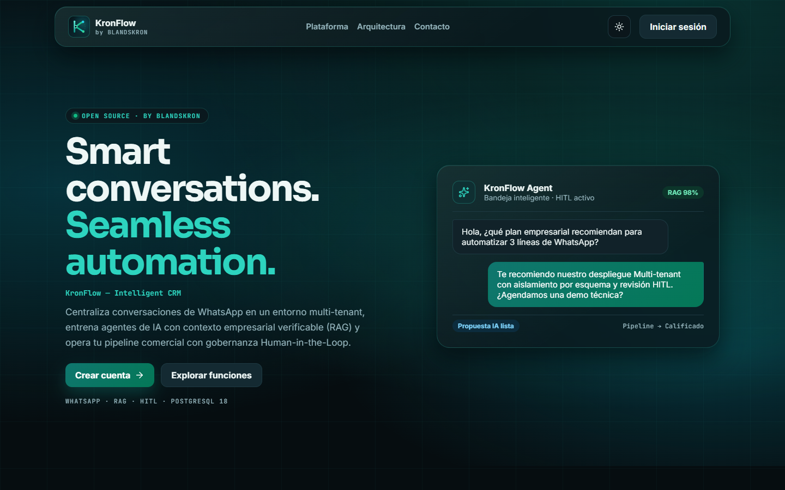
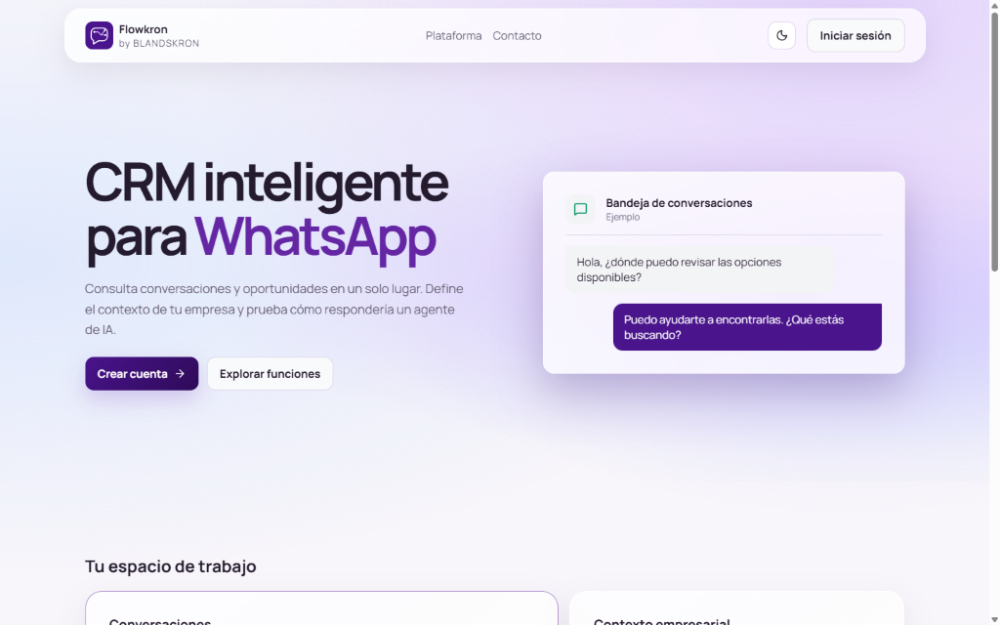
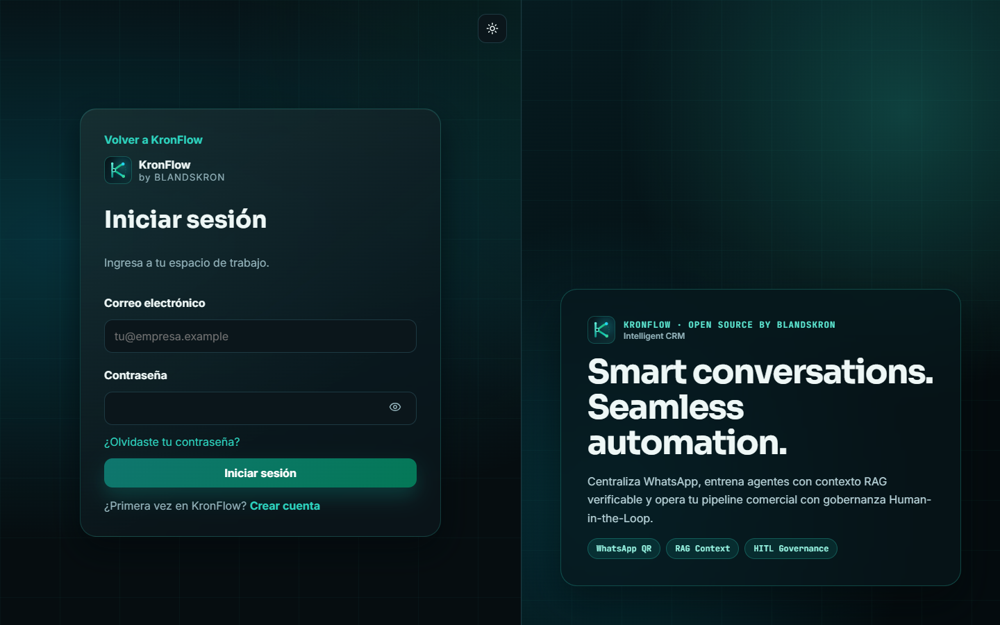
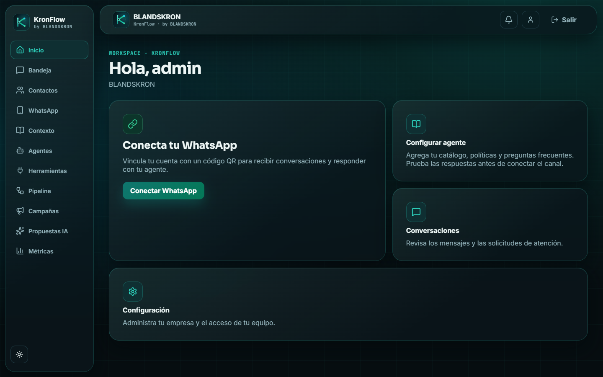
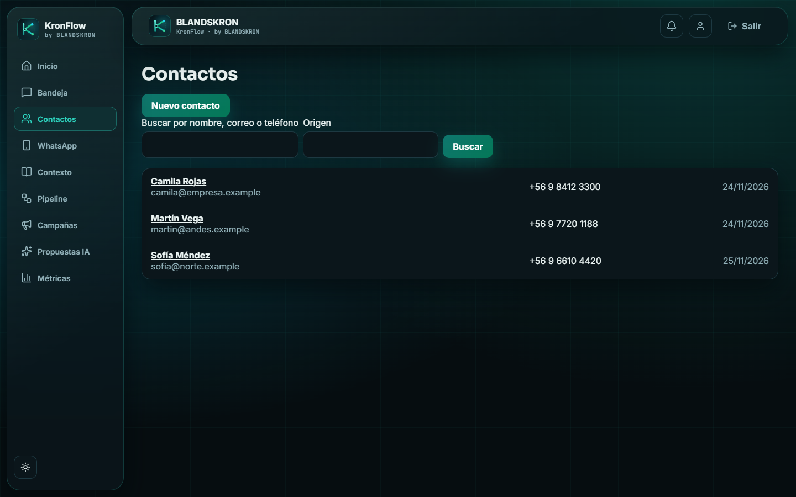
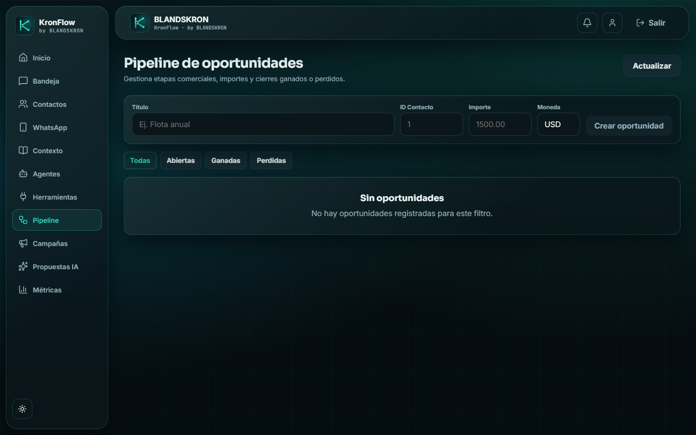
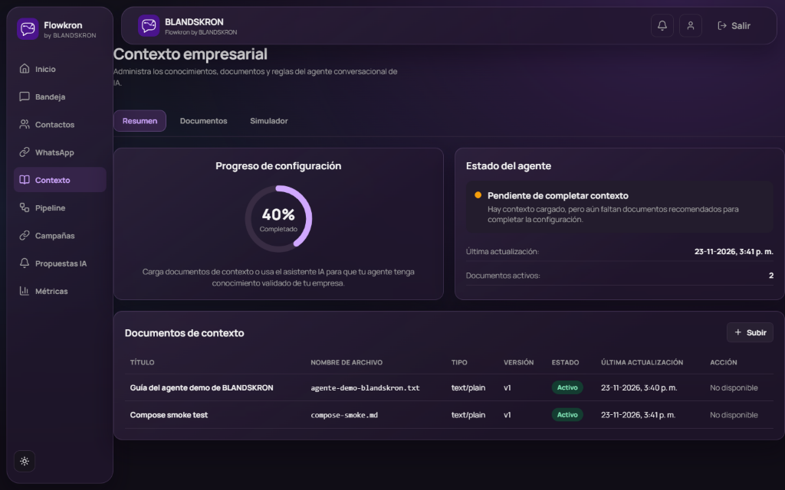
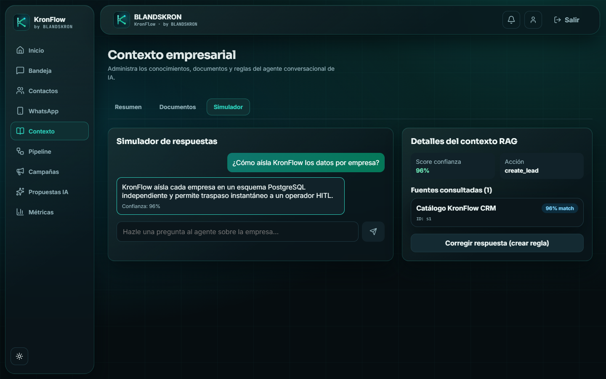
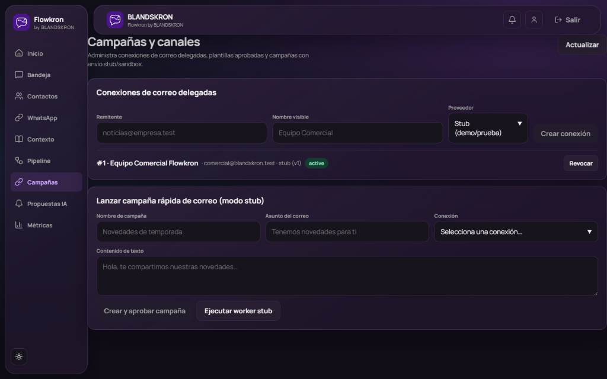
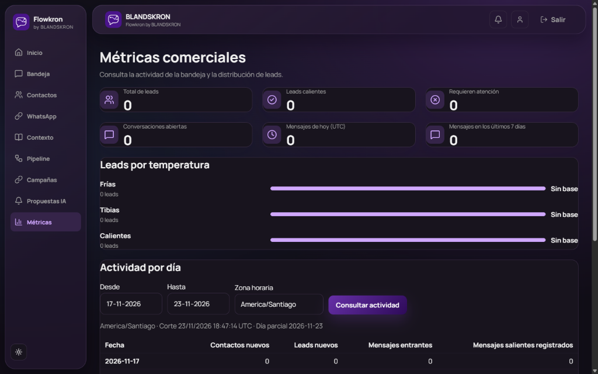

<p align="center">
  <picture>
    <source media="(prefers-color-scheme: dark)" srcset="assets/brand/kronflow-horizontal-dark.svg" />
    <source media="(prefers-color-scheme: light)" srcset="assets/brand/kronflow-horizontal-light.svg" />
    
  </picture>
</p>

<h1 align="center">KronFlow — Intelligent CRM</h1>

<p align="center">
  <strong>Smart conversations. Seamless automation.</strong><br />
  <sub>Open Source · By <strong>BLANDSKRON</strong> · Apache License 2.0</sub>
</p>

---

**KronFlow** (anteriormente *Flowkron*) es una plataforma CRM inteligente, modular y multi-tenant open source del ecosistema **BLANDSKRON**, diseñada para centralizar conversaciones de WhatsApp, gestionar contactos y oportunidades comerciales, operar propuestas tipadas de IA con contexto empresarial verificable (RAG) y gobernanza Human-in-the-Loop (HITL).

- **Multi-tenant schema-per-tenant:** cada empresa opera en su propio esquema PostgreSQL 18 aislado (`tenant_schema_v21`) con auditoría, retención y flujos de privacidad (`export` / `erase` / `retention`).
- **Frontend Angular 21 Zoneless:** 100% `OnPush`, Design System unificado Teal/Esmeralda/Cyan con tipografía `Sora` + `Inter` + `JetBrains Mono`, Floating Glassmorphism, modo oscuro/claro persistente, `0` violaciones WCAG 2.2 AA en `31/31` auditorías y Lighthouse Desktop `100/100/100/100` en Landing.
- **Orquestación RAG + HITL:** outbox transaccional durable, ledger de consentimientos, control humano CAS de conversaciones, simulador RAG con trazas de fuentes y aprobación `at-most-once` de acciones IA.

KronFlow es un proyecto independiente y no tiene afiliación ni respaldo de Meta o WhatsApp. Se distribuye bajo [Apache License 2.0](LICENSE). Consulta la [revisión de release](RELEASE_READINESS.md) y la [guía de despliegue y seguridad](deploy/README.md) antes de exponer una instancia.

## Capturas de la plataforma

Capturas reales generadas sobre los builds de producción de KronFlow (modo oscuro por defecto y modo claro con contraste WCAG 2.2 AA).

| Landing Pública · Modo Oscuro | Cambio de Tema · Modo Claro |
| :---: | :---: |
|  |  |
| **Inicio de Sesión · Auth IAM (JWT RS256)** | **Workspace Home · Shell CRM** |
|  |  |
| **Directorio de Contactos y Consentimiento** | **Pipeline de Oportunidades** |
|  |  |
| **Contexto Empresarial (RAG)** | **Simulador IA + Trazas de Fuentes** |
|  |  |
| **Campañas y Canales Delegados** | **Métricas Comerciales y KPIs** |
|  |  |

## Estructura del repositorio

```text
KronFlow/
├── backend/
│   ├── auth-service/          # IAM, JWT RS256, tenants, membresías y RBAC (Django)
│   ├── operational-service/   # CRM multi-schema PG18, inbox HITL, pipeline, campañas y privacidad (FastAPI)
│   ├── agent-core/            # Runtime conversacional omnicanal, RAG y simulador IA (FastAPI)
│   ├── mail-service/          # Gateway HTTP de correo transaccional e idempotencia Redis (FastAPI)
│   └── baileys-services/      # Conector WhatsApp QR por tenant con ingestión de consentimiento (Node/TS)
├── frontend/
│   ├── app/                   # KronFlow CRM Web App (Angular 21 Zoneless · OnPush)
│   └── landing/               # Portal público y formulario CSRF (Angular 21 Zoneless · OnPush)
├── deploy/                    # Stack Docker Compose modular, bootstrap y smoke E2E
├── assets/brand/              # Logotipos, isotipos, OG card y diagramas SVG oficiales
├── .agents/skills/            # Skills operativas del protocolo Agents-First
└── docs/screenshots/          # Capturas reales embebidas en README e index.html
```

## Inicio rápido local

Usa Docker Desktop o Docker Engine con el plugin Docker Compose. Desde la raíz del repositorio:

```sh
docker compose up --build --wait
```

Un checkout limpio arranca sin `.env`: el servicio `init` genera credenciales persistentes en volúmenes Docker. Agrega un `.env` privado a partir de [la plantilla](.env.example) únicamente para sobreescribir puertos o configurar proveedores externos. En Windows, clona en una ruta corta para evitar límites de longitud de ruta al construir las fuentes Angular.

| Superficie | Dirección local |
| --- | --- |
| Landing pública y contacto | http://localhost:8080 |
| KronFlow CRM | http://localhost:8081 |
| IAM health | http://localhost:8000/healthz/ |
| Operational readiness | http://localhost:8001/readyz |
| Agent Core readiness | http://localhost:8002/ready |
| Email gateway | Dirección interna en `http://mail-service:8000` |

### Arranque estándar (desde cero)

Abre la landing o el CRM, registra y verifica tu cuenta y crea tu empresa. KronFlow provisiona el esquema PostgreSQL aislado de la empresa durante el onboarding sin exigir selección de plan. Este modo arranca limpio, sin superusuario ni empresa demo precargada.

### Arranque demo

Ejecútalo de forma independiente al despliegue estándar (comparten puertos locales por defecto):

```sh
docker compose -f compose.demo.yaml up --build --wait
```

En el primer inicio, la demo crea el superusuario verificado `admin@example.com` como propietario de **BLANDSKRON** y carga un contexto empresarial genérico para el agente. Inicia sesión en [KronFlow CRM](http://localhost:8081/login) o [Django admin](http://localhost:8000/admin/) y consulta la contraseña generada desde tu terminal privada:

```sh
docker compose -f compose.demo.yaml exec -T auth-service cat /run/flowkron/bootstrap_admin_password
```

El correo de consola en desarrollo, las respuestas locales del agente y el conector de WhatsApp operan sin credenciales externas. Consulta la [guía de despliegue](deploy/README.md) para puertos, persistencia y diagnóstico.

## Registro de cuentas y Google Sign-In

KronFlow CRM admite registro por correo electrónico y acceso con Google Identity Services:

- Configura `GOOGLE_OAUTH_CLIENT_ID` en tu `.env` privado con el Client ID de una **aplicación web** de Google OAuth (vacío oculta el botón).
- En Google Cloud, registra `http://localhost` y `http://localhost:8081` (o tu origen HTTPS productivo exacto) en **Authorized JavaScript origins**, dejando **Authorized redirect URIs** vacío para el callback popup dedicado.
- Define `AUTH_SELF_SIGNUP_ENABLED=False` si la instancia debe aceptar solo usuarios existentes e invitaciones.
- Para dominios propios, configura `APP_PUBLIC_URL` y añade los orígenes de CRM y landing a `CORS_ALLOWED_ORIGINS`.

## Correo transaccional

El servicio incluido [KronFlow Mail Service](backend/mail-service/README.md) envía mediante la API HTTPS de Resend. Configura tu `.env` privado con:

```dotenv
EMAIL_BACKEND=apps.shared.email_backend.EmailGatewayBackend
MAIL_GATEWAY_URL=http://mail-service:8000
MAIL_INTERNAL_API_KEY=replace-with-a-generated-client-secret
MAIL_SENDER_KEY=flowkron
EMAIL_TIMEOUT=25
RESEND_API_KEY=
EMAIL_SENDERS_JSON='{"flowkron":{"from":"KronFlow <no-reply@example.com>"}}'
INTERNAL_CLIENTS_JSON='{"iam":{"api_key":"replace-with-a-generated-client-secret","allowed_senders":["flowkron"]}}'
```

Consulta `/health` para liveness y `/ready` para verificar configuración completa del proveedor y remitentes. También puede utilizarse un backend SMTP Django explícito o una URL HTTPS externa en `MAIL_GATEWAY_URL`.

## Canales y proveedor IA

- **WhatsApp:** empareja una cuenta por empresa escaneando el QR desde el CRM. El [conector Baileys](backend/baileys-services/README.md) registra consentimientos (`ACEPTO` / `BAJA`), ingesta texto con durabilidad y reenvía respuestas del agente.
- **IA / RAG:** configura `GROQ_API_KEY` en tu `.env` privado y recrea `agent-core` para usar Groq con `CHAT_PROVIDER=auto`. Revisa [backend/agent-core/README.md](backend/agent-core/README.md) para seleccionar modelo u operar en modo local.

## Centro de documentación

| Documento | Contenido |
| --- | --- |
| [Protocolo Agents-First](AGENTS.md) | Mapa operativo del monorepo, invariantes, comandos de validación y skills (`.agents/skills/`) |
| [Arquitectura e integración](ARCHITECTURE.md) | Topología de servicios, diagrama de flujo y fronteras de contratos HTTP/eventos |
| [Despliegue y operaciones](deploy/README.md) | Stacks Compose modulares, volúmenes persistentes, seguridad y validación smoke |
| [Microservicios backend](backend/operational-service/README.md) | Guías por servicio: [auth](backend/auth-service/README.md) · [operational](backend/operational-service/README.md) · [agent-core](backend/agent-core/README.md) · [mail](backend/mail-service/README.md) · [baileys](backend/baileys-services/README.md) |
| [Frontends Angular 21](frontend/app/README.md) | Guías por SPA: [CRM App](frontend/app/README.md) · [Landing Pública](frontend/landing/README.md) |
| [Contribución y pruebas](CONTRIBUTING.md) | Comandos locales para Angular 21, Python 3.12, Node 24 y Compose |
| [Release readiness](RELEASE_READINESS.md) | Criterios de liberación RC/producción y checklist operativo |
| [Historial de cambios](CHANGELOG.md) | Registro cronológico de evolución y notas de migración |
| [Política de seguridad](SECURITY.md) | Canal privado de divulgación y superficie crítica |
| [Terceros y licencias](THIRD_PARTY.md) | Dependencias clave, SBOM y obligaciones de redistribución |
| [Kit de marca SVG](assets/brand/README.md) | Logotipos, paleta Teal/Esmeralda/Cyan y reglas de uso |
