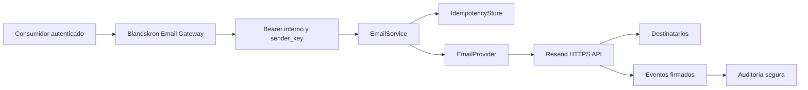

# Arquitectura

Las capas están separadas en `app/security.py`, `app/service.py`, `app/email.py`, `app/resend_provider.py`, `app/idempotency.py` y `app/webhooks.py`.

## Estado e idempotencia

- Con `REDIS_URL`, las reservas y resultados idempotentes viven 24 horas en Redis y la deduplicación de webhooks (`email-gateway:webhook:{svix_id}`) vive 7 días en Redis.
- Sin `REDIS_URL`, se usa memoria local (acotada para webhooks): reinicios y réplicas pierden la garantía compartida.

El servicio puede escalar horizontalmente de forma segura cuando `REDIS_URL` está configurado.
