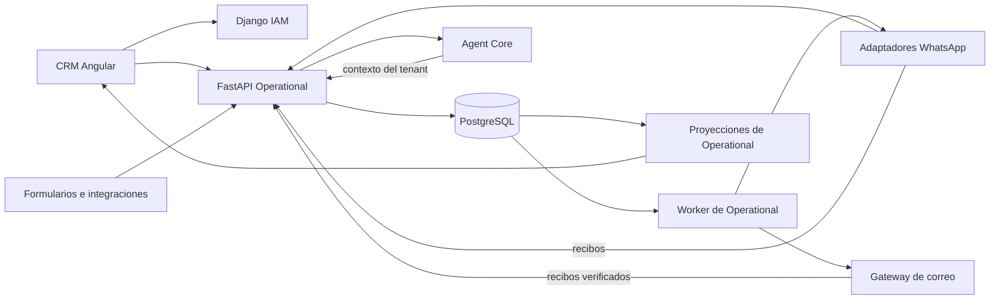

# Arquitectura objetivo y decisiones de Community v1

**Estado:** arquitectura activa de Community v1 (`tenant_schema_v21`). Se basa en la [arquitectura actual](../../../ARCHITECTURE.md) y sus [reglas de integración](../../../ARCHITECTURE.md#integration-contracts--service-boundaries). Los presupuestos de rendimiento son criterios de evaluación propuestos.

## ADR · Campañas y analítica como módulos de Operational

Operational conserva contactos, conversaciones, oportunidades, campañas y la publicación de eventos. Un proceso worker del mismo servicio consume trabajos en PostgreSQL y usa los adaptadores de canal. Analytics comienza con queries y, cuando la medición lo justifique, proyecciones en PostgreSQL. IAM conserva identidad y permisos. Agent Core calcula respuestas y propuestas, y el módulo dueño del recurso autoriza su aplicación.

| Criterio | Peso | A · Campaigns y Analytics internos | B · Campaign Service y Analytics interno | C · Campaign y Analytics separados |
| --- | ---: | ---: | ---: | ---: |
| Fuente única para contactos y consentimiento | 25% | 5 | 3 | 2 |
| Idempotencia, consistencia y recuperación | 20% | 4 | 4 | 3 |
| Aislamiento de carga y escalabilidad | 20% | 3 | 4 | 5 |
| Mantenimiento por un equipo pequeño | 15% | 5 | 3 | 2 |
| Coste de Compose, observabilidad y guardia | 10% | 5 | 3 | 2 |
| Adecuación al código y rollout gradual | 10% | 5 | 3 | 2 |
| **Resultado de diseño sobre 5** | **100%** | **4,40** | **3,40** | **2,80** |

La puntuación de 1 a 5 representa adecuación al criterio. A permite reservar un envío y revisar el consentimiento dentro de una transacción de Operational. B permite aislar el cómputo de campañas, con un contrato explícito de permisos de envío y sincronización. C permite escalar también las consultas analíticas y agrega otro ciclo de proyección y operación. La base de la decisión es que `WhatsAppTurnJob` ya evidencia el patrón de recuperación y `analytics_summary` usa SQL tenantizado. La medida histórica del inbox es local y acotada. [Patrón de recuperación](../../../backend/operational-service/docs/TURN_RECOVERY.md) · [Medición existente](../../../backend/operational-service/docs/TESTING.md)

### Cuándo reabrir la decisión

1. Medir con datos sintéticos, tamaños declarados y un reporte reproducible. Comparar carga inbound sola con inbound más outbound y luego con analítica, en tres corridas con la misma configuración. Registrar recursos, conjunto de datos, tasa de entrada, ventanas y estado de las colas.
2. Evaluar separar Campaigns si, durante tres corridas de 30 minutos a la carga acordada, el p95 de la primera página del inbox de 40 filas supera 250 ms o empeora más de 25% frente al control y el p95 de espera de trabajo outbound elegible supera 60 s. Antes de extraer, repetir con índices, cuotas por tenant y concurrencia del worker acotada, y atribuir el límite al recurso medido.
3. Evaluar separar Analytics si, tras aislar conexiones y probar proyecciones incrementales, el p95 del resumen supera 500 ms o la frescura p95 supera 60 s y las consultas analíticas elevan en más de 25% la latencia p95 del inbox. Reproducirlo en las tres corridas y demostrar la mejora con un prototipo aislado.
4. En una extracción, versionar contrato, medir retraso de proyección y ensayar replay desde un offset. Operational sigue emitiendo las autorizaciones de recurso y conserva los contactos. El rollback deshabilita el consumidor separado y reanuda el worker del módulo con los mismos IDs de trabajo y restricciones de unicidad.

## Límites y flujo

Las flechas indican dependencias objetivo. El proceso worker y la proyección de recibos de email corresponden a entregas futuras.

| Dominio | Fuente de verdad y límite |
| --- | --- |
| Identity y Tenant | IAM administra empresa, membresía, sesión, roles y credenciales de servicio. Operational conserva su runtime tenantizado como proyección del ciclo de vida. |
| Contact, Lead y PublicForms | Operational conserva `Cliente` como identidad canónica, normaliza puntos de contacto y mantiene la atribución de captación. El formulario institucional de IAM conserva su propósito actual. |
| Conversation y HITL | Operational posee mensajes, identidad, control humano/IA y auditoría de transiciones. Agent Core recibe el contexto mínimo requerido. |
| Sales y Opportunity | Operational conserva oportunidad, etapa, importe, responsable e historial comercial. Una oportunidad referencia un lead o contacto del mismo tenant y puede enlazar una conversación. |
| Campaign y Template | Operational conserva versión aprobada, audiencia, autorización, trabajo e historial. El worker consulta la política en Operational antes de enviar. |
| ChannelAdapter | Baileys y el gateway de correo convierten estados del proveedor a una evidencia normalizada y manejan credenciales de transporte. La vinculación de remitente y conexión se resuelve por tenant. |
| AI y Tools | Agent Core calcula respuestas y propuestas tipadas, con trazas según configuración. Operational decide, persiste y ejecuta los efectos aprobados usando el estado vigente. |
| Telemetry y Analytics | Los módulos emiten evidencia transaccional. Analytics mantiene proyecciones reconstruibles con control de acceso propio del tenant. |

## Persistencia, contratos y rollout

- **PostgreSQL** como almacén durable de trabajos y, si hace falta delivery separado, outbox. Escribir estado y trabajo en la misma transacción cuando deba sobrevivir a un reinicio. Reclamar trabajos en lotes acotados con lease, intento, fecha de siguiente ejecución y deduplicación. Usar inbox por ID de evento en consumidores con efectos para poder repetir entregas. El diseño reutiliza invariantes de turnos sin acoplar campañas al ciclo de respuesta de WhatsApp.
- **Redis** para usos efímeros como cuotas y caché o como señal de despertar. El estado, el cursor y la autorización de envío residen en PostgreSQL. La pérdida de Redis puede provocar degradación controlada y se comprueba recuperación desde la tabla durable.
- **HTTP y contratos.** Extender OpenAPI de Operational (`/openapi.json`) para contactos, formularios, oportunidades, control de conversación y campañas, manteniendo los sobres JSON estándar, `meta.tenant_id` resuelto, identificador de correlación, paginación estable y eventos versionados según [las fronteras de contrato](../../../ARCHITECTURE.md#integration-contracts--service-boundaries).
- **Esquema tenant.** Migraciones aditivas sobre v8 en el componente dueño. Orden propuesto: identidad y consentimientos, control y pipeline, campañas y trabajos, proyecciones. Ensayar schemas nuevos y existentes, repetir cada upgrade y validar datos históricos. Mantener lectura compatible durante el rollout. Si se revierte, desactivar rutas y workers nuevos, conservar las tablas y evitar reenviar trabajos inciertos. [Provisioning activo](../../../backend/operational-service/app/services/tenant_provisioning_service.py)

## Controles por límite

| Límite | Riesgo | Control y verificación propuesta |
| --- | --- | --- |
| Navegador → IAM/Operational | Claims vencidos o acceso cruzado | Resolver tenant por credencial, aplicar permisos por recurso y exigir vigencia de sesión para acciones sensibles. Probar acceso revocado y dos tenants con IDs locales iguales. |
| Formularios → Operational | Abuso, enumeración o consentimiento ambiguo | Token público por formulario, payload acotado, cuotas y respuesta genérica. La integración privada usa alcance puntual. Probar replay, tamaño y ausencia de permiso marketing implícito. |
| Operational → Agent Core → herramientas | Instrucciones maliciosas en contexto o efectos fuera de ámbito | Cuota por tenant, datos mínimos, propuestas tipadas y autorización a la hora de ejecutar. Probar rechazo de acción no aprobada con un agente simulado. |
| Worker → proveedor | Duplicación, baja concurrente o credenciales incorrectas | Un permiso de envío por trabajo, idempotencia estable, revalidación de baja y mapeo de conexión propio del tenant. Probar reclamantes, timeout y suspensión con canal simulado. |
| Proveedor → Operational | Recibos repetidos, ambiguos o de otra cuenta | Verificar autenticidad, vincular la cuenta a la credencial y deduplicar por evento, con transición monotónica. Probar firma inválida, repetición y llegada fuera de orden. |
| Proyecciones y respaldos | Acceso a PII o divergencia al recuperar | Separar roles, limitar payloads y ensayar reconstrucción y restore por tenant. Probar que el resumen cuenta solo eventos propios. |

La primera entrega mantiene el conjunto de servicios de Compose, los adaptadores existentes y la licencia actual. La extracción de microservicios, los brokers adicionales y el cambio de fuente de verdad requieren una decisión posterior respaldada por mediciones.
