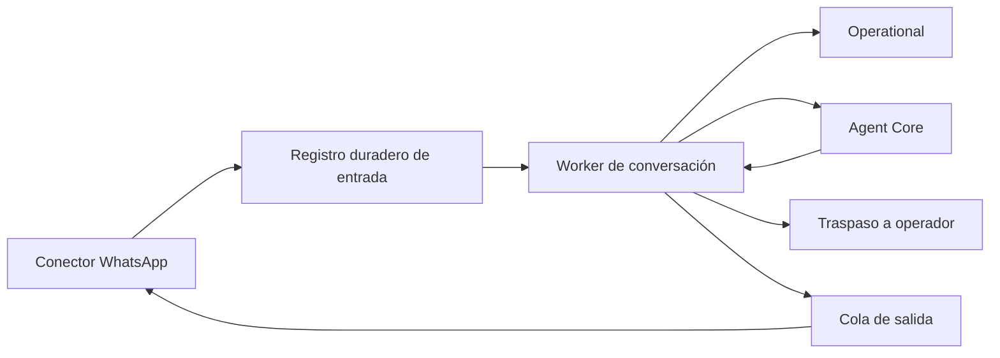

# Conexión de WhatsApp, agente y campañas

Flowkron tendrá un conector de canal independiente. La fase inicial conserva el vínculo QR y la recepción de mensajes de Baileys como piloto interno. Para campañas y avisos proactivos, el diseño utiliza WhatsApp Business Platform y plantillas aprobadas. Una plantilla local permite preparar texto y variables. El identificador, el idioma y la aprobación de la plantilla en el proveedor determinan si puede enviarse. [Política de mensajería de WhatsApp Business](https://whatsappbusiness.com/policy/)

## Qué se rescató del prototipo anterior

| Patrón observado | Aplicación en Flowkron |
| --- | --- |
| Socket Node que genera QR, conserva credenciales y notifica mensajes | Se conserva en el [conector experimental](../../flowkron-baileys-services/README.md). Usa un Bearer privado e ingesta autenticada para un tenant por instancia. |
| Webhook Django que buscaba el tenant, clasificaba el contacto y devolvía una respuesta | Operational ya ofrece ingesta, clasificación y traspaso. Agent Core propone una respuesta y acciones. El worker coordinará ambas APIs con un principal autenticado por tenant. |
| Kanban que pausaba la IA al transferir el caso y cerraba la conversación al terminar | Conservar las transiciones y la bitácora. El workflow gestiona el estado del caso y el conector transporta eventos y mensajes. |
| Plantillas con variables, selección de destinatarios y resultados por contacto | Conservar el flujo de producto. Usar trabajos duraderos por destinatario y estados de entrega del proveedor para sustituir el bucle síncrono. |
| Django paralelo, SQL de negocio y sesiones en archivos | El piloto reutiliza la arquitectura de Flowkron. Solo conserva el código adaptado del conector, con un directorio de sesión nuevo. |

El servicio fija `baileys@7.0.0-rc14`. El rango original permitía versiones antiguas de la familia 6.7. WhiskeySockets publicó una corrección crítica en 6.7.22 y 7.0.0-rc12. La versión 7 utilizada sigue siendo candidata y cambia el manejo de identificadores LID. El piloto obtiene el teléfono del JID telefónico y omite eventos con un LID sin correspondencia. Baileys usa MIT y su dependencia `libsignal` usa GPL-3.0. Antes de distribuir imágenes del conector, revisar las obligaciones de empaquetado y atribución de esa dependencia. [Aviso de seguridad](https://github.com/WhiskeySockets/Baileys/security/advisories/GHSA-qvv5-jq5g-4cgg) · [Migración a v7](https://github.com/WhiskeySockets/baileys.wiki-site/blob/main/docs/migration/to-v7.0.0.md) · [Notas sobre libsignal](https://github.com/WhiskeySockets/Baileys/releases/tag/v7.0.0-rc11)

## Fase 1 · Piloto incluido

- Un operador inicia el vínculo y consulta el estado y QR desde la API interna. Las credenciales se guardan en un volumen local. Tras reiniciar el proceso, el operador reabre el vínculo.
- Con la ingesta configurada, el conector acepta texto directo entrante en eventos `notify`, normaliza el identificador y consulta el consentimiento existente antes de enviar texto a Operational. Omite el historial, los grupos, sus propios mensajes y los adjuntos.
- Cada instancia usa un tenant configurado fuera de los payloads. Operational valida el tenant, el plan y la clave. La ingesta del piloto es de mejor esfuerzo. Una caída antes de confirmar el mensaje puede perder el evento. La captura inicial de consentimiento queda pendiente.

## Fase 2 · Primer paso del CRM

1. Autenticar al usuario y seleccionar o crear su empresa. Mostrar **Conectar WhatsApp** antes de abrir el espacio de trabajo.
2. Registrar una conexión por tenant con proveedor, estado, identificador interno y última verificación. El backend deriva el tenant del JWT y comprueba la membresía. Generar el QR o desvincular requiere un permiso explícito. Otros miembros ven el estado y cómo contactar al responsable.
3. Servir a Angular el estado y QR de vida corta desde el backend autenticado. Mostrar indicaciones de escaneo, expiración, reintento y revocación. Mantener acceso a configuración y cierre de sesión. Aprovisionar la credencial de ingesta cuando el tenant tenga runtime habilitado.
4. Usar un almacén cifrado con exclusión por conexión antes de operar varias sesiones por proceso. El CRM, la cola y el agente no necesitan recibir claves de Baileys. [Documentación de conexión](https://github.com/WhiskeySockets/baileys.wiki-site/blob/main/docs/socket/connecting.md)

## Fase 3 · Agente y workflow por eventos

- Registrar `tenant + conexión + ID del proveedor` antes de ejecutar reglas. Procesar eventos en orden por conversación. Persistir el estado y la salida juntos mediante un outbox y recuperar el trabajo después de reiniciar.
- Reutilizar la ingesta de Operational para mensajes, consentimiento, clasificación y traspaso. Operational registra IDs procesados. El worker necesitará su propia deduplicación de efectos y pruebas con entregas concurrentes.
- Invocar `POST /api/v1/agent/messages` con `channel=whatsapp` y la conversación normalizada. Agent Core valida un principal con tenant. Implementar credenciales de servicio con alcance de tenant antes de conectar el worker.
- Evaluar `requires_human` y el estado operativo antes de encolar una respuesta. Pausar IA al transferir el caso y registrar quién cambió el estado. Una acción de agenda, correo o tickets pasa por su ejecutor autorizado.
- Validar en sandbox el vínculo y la revocación, el aislamiento de tenants, la repetición de eventos, el orden por conversación y la pausa tras el traspaso.

## Fase 4 · Campañas y eventos automáticos

- Guardar plantillas por tenant con versión, idioma, categoría, variables, estado de aprobación e identidad en el proveedor. Mostrar una previsualización y contar destinatarios elegibles y excluidos antes de publicar.
- Conservar la autorización para cada propósito y revisar bajas y supresiones al preparar la audiencia y antes de enviar. El consentimiento de datos y el permiso de mensajería proactiva son registros distintos.
- Permitir disparadores como confirmación de cita, cambio de etapa o seguimiento programado. Registrar zona horaria y origen. Usar una clave de idempotencia formada por tenant, evento, destinatario y versión de plantilla.
- Crear un trabajo por destinatario. Distinguir preparado, en cola, aceptado, entregado, leído, fallido y excluido. Aplicar límites, pausa, cancelación y reintentos con backoff. Reconciliar la entrega antes de repetir un envío con resultado incierto.
- Validar en sandbox disparo único, exclusiones, bajas posteriores a la programación, webhooks repetidos y respeto del estado de aprobación de la plantilla. [Política de mensajería de WhatsApp Business](https://whatsappbusiness.com/policy/)

El piloto implementa vínculo, estado e ingesta de texto con consentimiento existente. Las fases 2 a 4 documentan trabajo futuro. La validación automatizada usa eventos y APIs simulados. Queda por probar el escaneo y la ingesta real con una cuenta de laboratorio.
